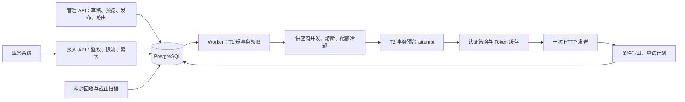

# rc_haohui：内部 HTTP 通知服务

业务系统提交 `tenantId + operation + eventId + data`，服务根据已发布配置组装供应商请求，持久化后异步投递。新增支持范围内的供应商，通过配置模板、认证和路由完成；业务系统无需处理供应商协议、Token 和重试。

## 从全新 checkout 开始

需要 **JDK 17、Python 3.11+、Docker Engine / Docker Desktop 和 Docker Compose v2**。Maven Wrapper 会下载固定版本的 Maven 和依赖；Docker 构建使用固定摘要的基础镜像。先进入本仓库根目录。以下命令使用独立 Compose 项目和测试数据卷；可复用本机依赖及镜像缓存。

```sh
java -version
python3 --version
docker compose version

# 仅在全新 checkout 中复制；已有 .env 时保留自己的配置。
cp .env.example .env
export COMPOSE_PROJECT_NAME=rc-haohui-fresh
export TEST_DATABASE_PORT=55434
docker compose --profile test up -d --wait test-postgres

export TEST_DATABASE_URL=jdbc:postgresql://127.0.0.1:55434/rc_test
export TEST_DATABASE_USER=rc_test
export TEST_DATABASE_PASSWORD=rc_test_local_only
bash scripts/verify.sh

# Dockerfile 封装上一步完整验证生成的 jar。
docker compose --profile all build
docker compose --profile all up -d --wait
curl --fail http://127.0.0.1:18080/health/ready

# 唯一的交互式演示入口；每次指定新的 run-id。
python3 scripts/demo.py --run-id demo-001
```

`scripts/verify.sh` 执行 `clean verify`，随后拒绝任何失败、错误、跳过或缺失测试报告；缺少真实 PostgreSQL 会失败，不会跳过集成测试。需要复用指定缓存时可用 `MAVEN_USER_HOME=/your/maven-home bash scripts/verify.sh -Dmaven.repo.local=/your/m2`。测试数据库拥有创建隔离 schema 和测试角色的权限，与演示应用数据库分离。

Docker 网络不可用但已有基础镜像缓存时，可为 build 指定 `--build-arg JAVA_IMAGE=本地标签`、`PYTHON_IMAGE=本地标签`、`POSTGRES_IMAGE=本地标签`；仅使用已核验与 Dockerfile 固定摘要对应的镜像，不替换版本。CP10 实跑的摘要校验与缓存标签记录在 [base-images.json](docs/reports/CP10/base-images.json)。

默认凭据均为**公开假值，仅用于本地演示**。API 在 `127.0.0.1:18080`，Mock 在 `19090`，演示 PostgreSQL 在 `55433`；完整说明见 [演示步骤](docs/DEMO.md) 和 [部署说明](deploy/README.md)。若已有另一套本仓库演示在运行，先停止它：应用端口和固定 Mock 子网不能同时占用。普通 `docker compose down` 保留数据卷；需要保留记录时不要使用 `down -v`。

## 问题理解与系统边界

业务系统需要的是“可靠受理一项外部通知”，供应商协议和短暂故障不应进入注册、付款等主业务流程。服务接收业务数据，根据租户和操作选择配置，在同一数据库事务中保存事件身份、请求快照和任务，提交后返回 `202`。Worker 随后获取认证并执行 HTTP。

| 本版解决 | 本版不解决及原因 |
| --- | --- |
| 单个事件对应一个目标；固定 URL；POST/PUT/PATCH；JSON 或 form Body；配置化 Header、字段取值和类型校验 | 多目标编排、条件分支、任意脚本、XML、供应商私有签名协议；这些会显著扩大执行与安全边界，需要新增明确能力 |
| API Key、OAuth2 client_credentials（Basic/Post）、有界 Token 缓存与并发合并 | 用户授权登录流程、浏览器 OAuth、密钥管理平台；MVP 使用部署层 Secret 引用和租户白名单 |
| 持久化、并发领取、有限重试、过期回收、失败查询、人工重投、配置版本和审计 | 业务结果解释、下游事务补偿、严格顺序、exactly-once；服务只判断 HTTP 确认 |
| 多 Worker 共用 PG，应用资源有界，供应商隔离、熔断和过载拒绝 | PostgreSQL 高可用、灾备、跨地域容灾、历史归档；演示部署是单机，不代表生产运维能力 |

`202` 表示任务已持久化，**不表示供应商已收到**。收到完整最终 `2xx` 响应头表示 HTTP 确认，服务不读取供应商业务返回值。超时、宕机或确认丢失可能导致重复请求；`failed` 表示本轮自动处理停止，不能据此断言外部副作用没有发生。

## 架构与核心设计



一个 Java 17 / Spring Boot 应用，按职责分包。`APP_MODE=all` 同时提供 API 与 Worker；`api` 仅接入与管理，`worker` 仅执行任务，三者都有健康检查。PostgreSQL 同时保存配置、任务、attempt 历史和审计。网络调用发生在数据库事务之外。

供应商差异通过三类版本化配置表达：**模板**决定 URL、普通 Header 和 Body 映射；**认证配置**决定 API Key 或 OAuth 参数及 Secret 引用；**路由**将 `(tenantId, operation)` 绑定到两个已发布版本。`AuthStrategyRegistry` 选择认证策略，`BodyEncoder` 选择 JSON/form 编码器。增加已有协议的供应商只增加配置；新增 HMAC 等协议才增加策略实现，不为每个供应商生成一个工厂子类。

映射只支持常量或受限字段路径、明确类型和必填约束，不执行表达式或代码。JSON 保留数值与类型；form 限定非空标量。草稿带修订号，发布需 `expectedRevision`，已发布内容不可变，路由在事务中原子切换。接入时冻结实际 Body 字节、普通 Header、目标与版本引用，重试和人工重投沿用这个快照。配置升版、回滚不重新渲染已经受理的任务。两种供应商配置见 [examples/configuration](examples/configuration/README.md)。

## 可靠性、重试与幂等

采用**有界、可恢复、允许重复的至少一次投递模型**：在次数和时限内尽力投递，达到边界后保留失败任务供检查和重投，不承诺任意故障下最终成功。依赖下游业务幂等才能避免重复副作用；可把 `eventId` 映射为供应商认可的幂等字段。

| 机制 | 实际行为 |
| --- | --- |
| 受理幂等 | PG 唯一键 `(tenantId, operation, eventId)`；相同规范化请求返回原任务 `200`，不同数据 `409`；数字 `1/1.0/1e0` 等价。鉴权先于查重，已受理事件不依赖当前模板重新校验 |
| 事务与所有权 | T1 领取租约；T2 独立事务预留 attempt 并计次；T3 保存发送意图；T4 校验任务、轮次、租约 token、状态和未过期租约后写回。旧 Worker 即使尚未被接管也不能过期写回 |
| 默认预算 | 租约 90 秒、attempt 30 秒、业务 HTTP 10 秒、Token 5 秒；每轮最多 12 次 attempt、24 小时。不续租；认证失败及预留后宕机也消耗 attempt |
| 自动重试 | 网络/超时、408、429、5xx 可重试；普通 4xx 为永久失败。30 秒基数、1 小时指数上限、Full Jitter；有效 Retry-After 是下限，不截短；下一次已达截止或次数耗尽则失败 |
| 单次发送 | 每个 attempt 最多一次业务 HTTP。客户端禁止自动重试、重定向、认证挑战重发；未知结果记录 `UNKNOWN`，不能当成确定未发送 |
| OAuth 401 | 仅合法 Bearer `invalid_token` 挑战可消耗每轮一次恢复机会；持久化恢复意图后在下一 attempt 获取新 Token。普通 401、403、API Key 不触发刷新；刷新仍为被拒绝 Token 则终止 |
| 故障回收 | PG 时间决定租约、调度与截止。过期 `processing` 可被其他 Worker 回收，可能重新发送；独立扫描终止到期 `pending`。纯延期和无 attempt 的回收不覆写上次投递结果 |
| 人工重投 | 仅失败任务可重投；新轮次、原快照、累计历史不丢失。`replayRequestId` 与参数摘要保证同请求固定响应，冲突返回 409；操作与审计同事务 |

单 Worker 默认全局并发 10、每供应商 3；领取前取得许可，不占着全局资源等待慢供应商。有界轮转防止某个供应商长期独占扫描。熔断、429 配额冷却、认证短冷却在 T2 前可以延期且不计次；T2 后发现冷却则保留已消耗的 attempt。API 基础限流返回 429，积压过高返回 503，既有幂等事件可越过积压检查，但仍经过鉴权和基础限流。

**Token 缓存、singleflight、熔断、限流、冷却和并发额度均为进程内机制。** 多 Worker 通过 PG 保证任务所有权，不能据此推导全局 Token 唯一或供应商集群配额；增加实例会叠加本地额度。供应商必须允许多个实例 Token 共存。

## 认证、安全与可观测性

数据库保存 `clientId`、Token URL、认证方式、scopes 和 `secretRef`，不保存明文 Secret 或 Token。部署层为每个租户明确授权可用的逻辑引用，默认拒绝；共享引用需分别授权。实际发送前重新校验权限，撤销授权也影响旧任务。示例使用环境变量及相应 `_VERSION`；轮换值和版本后重启相关 Worker，同一逻辑引用无需改模板。

Token 按环境、租户、认证版本、凭据版本、URL、clientId、认证方式和规范化 scopes 隔离。缓存上限 1000；同键并发共享一次交换，单个等待者超时不取消其他等待者。有效期从获取开始按单调时钟计时，取得时和实际业务发送前都检查安全余量；获取失败采用短冷却。缓存丢失只影响效率，不丢失持久任务或 401 恢复意图。

出站配置有目标名称、端口限制，真实连接阶段再次校验完整 DNS 结果与 IP 地址；不跟随重定向，保留 TLS 证书链和主机名验证。开发 Mock 例外严格限定 `mock:9090` 和 `172.30.86.10/32`，生产环境禁止开发例外。有限地址策略不能识别所有部署网络的特殊路由，生产仍需出口网络约束。入站与渲染 Body 上限均为 256 KiB；DNS、TLS、HTTP、响应头和 Token Body 有资源边界。

日志使用 requestId→notificationId 关联接入，再用 notificationId、run、attempt、executionId 关联投递；不记录 Header、业务 Body、Secret、Token 或供应商响应正文。**任务数据库仍保存投递所需的业务快照**，需要限制访问和配置备份、保留期限。管理、业务、运维角色及租户/操作权限独立校验。

`/health/live` 与 `/health/ready` 用于进程和数据库/schema 检查。ADMIN 可访问 `/actuator/metrics`，其他 Actuator 端点不开放。任务状态 Gauge 属于数据库整体，多个实例不能求和；计数器按进程重置；采样 success/age 用于识别旧值。HTTP 调用完成指标不等于业务成功，成功结果应看任务状态或 Worker decision 指标。

## 关键工程取舍

| 选择 | 原因与代价 |
| --- | --- |
| Java 17 + Spring Boot + 显式 JDBC | 适合事务、线程资源控制、成熟 HTTP/安全库；SQL 明确展示领取与 fencing 条件。用策略接口承接真实变化点，避免每层都建抽象工厂 |
| PostgreSQL 任务队列，不先加 MQ | 一次事务完成受理、幂等与任务落库，没有数据库和 MQ 双写窗口；代价是轮询和数据库负载。先测索引与容量，出现瓶颈再采用事务 Outbox + MQ |
| 本地 Token 缓存，不先加 Redis | MVP 不需要缓存高可用才能保存任务，bounded singleflight 足以合并本进程请求；代价是多实例重复获取。仅在供应商只允许一个活动 Token、严格全局配额或交换压力有证据时引入共享协调 |
| 配置在数据库，发布版本不可改 | 供应商字段变化无需服务重新发版，且可审计与回滚；代价是版本管理和旧任务语义必须明确。新增不支持的协议仍需要代码发布 |
| 有限映射和有限重试 | 限制脚本注入、不可预测运行成本、永久失败风暴；不支持任意复杂转换，也不无限等待长期不可用的供应商 |
| 单镜像多角色与独立迁移 | 保留 API/Worker 独立扩容能力，不先拆微服务；运行账号无 DDL/DELETE/TRUNCATE，迁移账号单独使用。部署仍需管理数据库和凭据生命周期 |

未采纳的复杂设计与实际纠正过程见 [AI 使用说明](AI_USAGE.md)，其中区分用户在历史对话中做出的判断和 AI 在实施中补充的细节。

## 已完成的验证与实际限制

CP11 已从全新源目录和 PostgreSQL 数据卷重新运行 **51 个套件、531 个执行实例，失败/错误/跳过为 0**。包括真实 PG 的事务与并发、真实 HTTP/TLS/DNS 安全、Token 缓存、独立 JVM 强杀、DB 断开/恢复、旧 Worker 写回拒绝、配置/重投竞态和最小数据库权限。单进程与独立 API + 双 Worker 的文档演示均已实跑，另用全新部署重复了 200 条在途强杀恢复。逻辑需求编号与参数化执行实例不是同一种计数；逐项证据见 [最终报告](docs/reports/CP11/REPORT.md)、[验收矩阵](docs/reports/CP11/ACCEPTANCE_MATRIX.md)。

| 实测场景 | 结果 |
| --- | --- |
| 基线：10 租户、约 1 KiB、20 rps × 600 秒、Mock 200/100 ms | 12000 条全部受理并成功；接入 P95 6.607 ms；受理至首次实际业务 HTTP P95 0.09758 秒，包含 Token 等待 |
| 阶梯压力：9000 次输入 | 3605 条受理并成功；1601 条 429、3794 条 503 均无任务入库；停止输入后 18.43 秒排空 |
| 故障突发：A/B 各 100 条，A 前 15 秒超时 | B 在 4.071 秒全部成功，A 在 19.353 秒全部成功 |
| 双 Worker 在途强杀并恢复 | 200 条最终成功，实际 HTTP 204 次、Mock 去重副作用 200 次，直接展示允许重复的语义 |

数据来自 Apple M5、单机 Docker、单 PG 和受控 Mock，不能视为公网供应商的生产 SLA。压力场景首次发送 P95 为 **17.965 秒**，不满足正常基线的 3 秒目标；没有用过载数据冒充基线达标。最大并发、CPU/内存限制、失败实验、原始对账和镜像摘要见 [CP10 报告](docs/reports/CP10/REPORT.md)；独立进程故障见 [CP09 报告](docs/reports/CP09/REPORT.md)。

继续演进时，先根据等待时长、积压和 PG 执行计划扩容 Worker、调整供应商额度并归档历史；数据库出现实际瓶颈后再分片或引入 Outbox/MQ。严格集群配额或单活动 Token 需要 Redis 等协调机制及其故障语义。生产落地还需数据库高可用/备份恢复、集中 Secret 管理、出口网络策略、配置审批、审计保留与目标环境容量验证。

## 文档与入口

| 内容 | 位置 |
| --- | --- |
| 产品范围与验收 | [PRD](docs/PRD.md)、[测试用例](docs/TEST_CASES.md) |
| 数据模型、事务、缓存与安全细节 | [技术设计](docs/TECHNICAL_DESIGN.md) |
| 阶段门禁与证据 | [Checkpoints](docs/CHECKPOINTS.md)、[阶段报告](docs/reports/) |
| 实际演示、接口示例与预期失败解释 | [DEMO](docs/DEMO.md)、[demo.py](scripts/demo.py) |
| 部署、负载与故障复现 | [部署](deploy/README.md)、[负载脚本](scripts/perf/README.md)、[故障说明](examples/faults/README.md) |
| 提交要求中的 AI 协作说明 | [AI_USAGE.md](AI_USAGE.md) |
