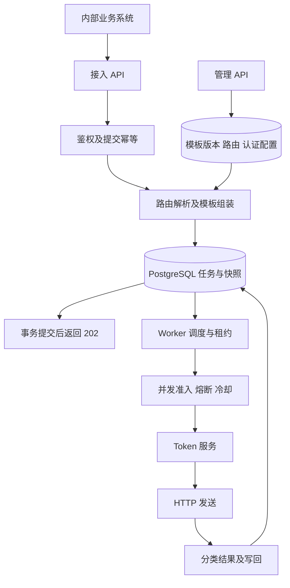
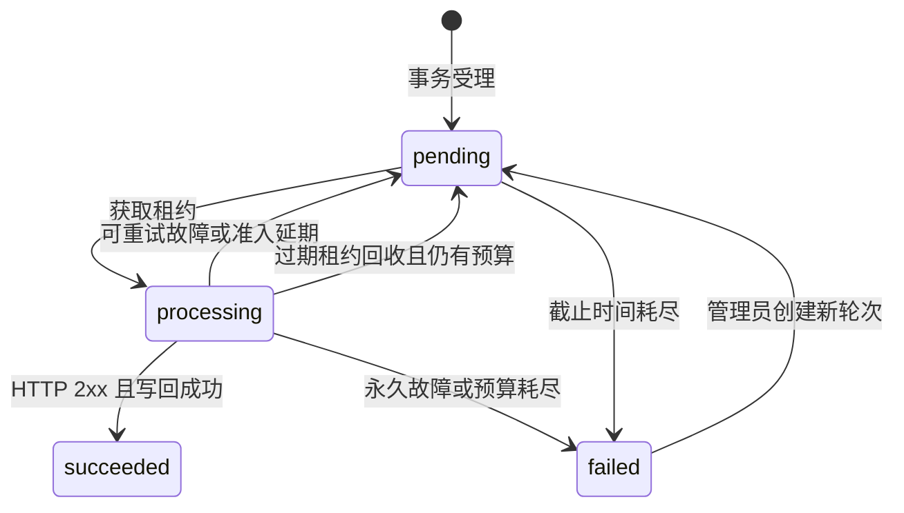

# 内部 HTTP 通知服务产品需求文档

| 项目 | 内容 |
| --- | --- |
| 产品名称 | 内部 HTTP 通知服务 |
| 项目仓库 | `rc_haohui` |
| 文档版本 | 1.0 |
| 更新日期 | 2026 年 10 月 12 日 |
| 适用阶段 | MVP 实现与验收，高并发和分布式能力分阶段演进 |
| 目标读者 | 开发者、测试与运维人员、作业评审者 |

本服务接收内部业务系统提交的通知意图，根据租户和操作对应的配置生成外部 HTTP 请求，在持久化受理后异步投递。产品重点是隔离供应商差异，提供可恢复的投递、可追踪的失败和可解释的工程边界。

采用 Java、Spring Boot 和 PostgreSQL。供应商请求模板保存在数据库中，以版本方式发布；任务固定请求快照，动态认证信息在实际发送时获取。第一版实现有限重试、提交幂等、租约恢复、并发隔离和进程内熔断，不依赖 Redis 或独立消息队列。

本文中的性能数值为拟定的验收目标或默认配置，不代表已经完成的测试结果。实现完成后，应提交测试环境、实际数据和未通过项。

## 1 背景与目标

企业内部多个业务系统需要在注册、付款、购买等事件发生后调用外部供应商 API。不同供应商的地址、认证方式、请求头和请求体不同，供应商故障和网络异常也不应占用业务请求的执行时间。

上游通过统一接口提交 `tenantId`、`operation`、`eventId` 和业务数据。通知服务负责协议映射及投递，业务系统只等待受理结果，不等待供应商响应。提交失败或响应丢失时，上游仍须使用原事件标识重试提交。

### 1.1 产品目标

| 编号 | 目标 | 验收依据 |
| --- | --- | --- |
| G01 | 已确认受理的任务在应用进程重启后仍可恢复 | 强制终止进程后恢复任务，任务数量与受理记录可核对 |
| G02 | 常规供应商差异通过配置接入 | 新增第二个 Mock 供应商仅修改配置，不修改 Java 代码 |
| G03 | 临时故障自动恢复，长期故障可定位 | 重试、截止时间、失败查询和人工重投场景通过 |
| G04 | 多 Worker 并发处理时状态正确 | 并发领取、租约回收、过期 Worker 写回测试通过 |
| G05 | 一个供应商故障不占满全部投递资源 | 慢供应商与健康供应商混合测试通过 |
| G06 | 关键取舍可解释、可复现 | README、测试记录和真实 AI 使用说明齐备 |

### 1.2 投递契约

`202 Accepted` 只表示任务已经提交数据库事务。服务在有限预算内提供可恢复、允许重复的投递尝试；不承诺任意故障下最终成功送达，也不承诺供应商业务恰好执行一次。

收到 HTTP `2xx` 表示供应商在 HTTP 层确认接收。第一版不解释供应商响应体中的特定业务码，也不验证其最终业务副作用。任务 `failed` 表示自动处理已停止，不等于供应商从未处理该请求。

上述持久化承诺以 PostgreSQL 正常持久化、数据卷保留为前提。数据库介质损坏、异步副本切换丢失未复制事务等灾难场景，不属于第一版的零数据丢失保证。

## 2 术语与使用角色

| 术语 | 定义 |
| --- | --- |
| 调用方 | 经过认证的内部业务系统，拥有指定租户和操作的访问权限 |
| 租户 | 业务客户或隔离域，不代表外部供应商 |
| 操作 | 稳定的业务动作名称，例如 `user.registered`；其输入数据契约由接入双方约定 |
| 供应商 | 实际接收 HTTP 请求的外部系统 |
| 模板版本 | 对 URL、方法、普通请求头和 Body 映射的不可变定义 |
| 路由绑定 | 一个租户和操作到一个模板版本及认证配置版本的关联 |
| 任务 | 一次业务通知及其固定请求快照；第一版对应一个目标 |
| 处理轮次 | 初次投递或一次人工重投所开启的预算周期，以 `runNumber` 标识 |
| 处理尝试 | 在一次轮次内预留预算后执行认证准备及最多一次业务 HTTP 请求 |
| 租约 | Worker 在规定时间内持有任务的处理资格 |
| 最后投递结果 | 区分未发送、收到响应和结果未知，与任务状态分别记录 |

业务开发者提交和查询本租户任务；配置管理员维护模板、路由和认证配置；运维人员查询失败、执行授权范围内的重投。MVP 使用内部凭证配置映射角色、租户和允许操作，不建设用户管理平台。

典型使用场景如下。

| 场景 | 操作示例 | 预期行为 |
| --- | --- | --- |
| 注册成功通知广告平台 | `user.registered` | 按渠道对应的已配置绑定生成注册回传请求 |
| 订阅付款通知 CRM | `subscription.paid` | 映射联系人标识和状态，取得有效 Token 后发送 |
| 购买完成通知库存系统 | `order.purchased` | 发送商品与数量，保留事件标识以供供应商去重 |
| 供应商短暂不可用 | 任意操作 | 自动退避，恢复后继续投递 |
| 模板字段调整 | 任意操作 | 发布新版本，新任务使用新版，历史任务快照不变 |

若同一租户的同一操作需要根据渠道动态选择多个供应商，第一版应划分明确操作或绑定，不支持在模板内执行条件路由。动态路由和一对多投递属于后续能力。

## 3 产品范围与系统边界

### 3.1 第一版必须实现的能力

| 需求编号 | 能力 | 第一版范围 | 主要验收场景 |
| --- | --- | --- | --- |
| FR01 | 统一接入 | 提交、查询、失败列表与租户权限校验 | AT01 AT24 AT26 |
| FR02 | 提交幂等 | 数据库唯一约束、同事件同数据复用、不同数据冲突 | AT03 AT04 AT08 |
| FR03 | 配置管理 | 数据库模板、草稿、校验、预览、发布、绑定切换和回滚 | AT06 AT07 |
| FR04 | 请求组装 | 字段取值、常量、必填和类型校验，JSON 与表单编码 | AT02 AT05 |
| FR05 | 供应商认证 | 静态 API Key 与 OAuth2 客户端凭证模式 | AT01 AT17 AT19 |
| FR06 | Token 管理 | 本地缓存、有效期判断、并发获取合并、条件失效 | AT17 AT18 |
| FR07 | 异步调度 | 持久化任务、短事务领取、租约回收、条件写回 | AT12 至 AT16 |
| FR08 | 失败恢复 | 超时、分类重试、退避、截止时间与最终失败 | AT09 AT10 AT11 AT27 |
| FR09 | 资源保护 | 有界并发、供应商隔离、进程内熔断和 429 冷却 | AT20 AT21 AT22 |
| FR10 | 人工恢复 | 原快照重投、新轮次预算、操作幂等和历史保留 | AT23 |
| FR11 | 可观测性 | 脱敏日志、尝试记录、基本指标、健康检查 | AT10 AT19 AT24 AT26 |
| FR12 | 部署与验证 | 同一应用支持 API、Worker、混合模式及双 Worker 演示 | AT16 AT28 |

### 3.2 明确不解决的问题

服务不判断业务事件是否真实，不为上游补齐缺失字段，不承担支付、库存等业务计算，也不提供补偿事务。业务事件产生到提交本服务之前的丢失，由调用方重试或事务 Outbox 解决。

第一版不支持供应商业务结果回调、跨目标原子投递、严格事件顺序、任意脚本、动态类加载、通用工作流或可视化管理后台。HTTP `200` 携带业务失败码的识别、用户授权 OAuth、HMAC 等特殊签名、XML 或二进制附件等新编码能力，通过后续策略扩展实现。

Redis、独立 MQ、跨实例严格全局限流、集群级单探测熔断、数据库容灾和分库分片不属于第一版验收范围。第一版的多 Worker 正确性不等同于所有保护策略已经全局协调。

### 3.3 接入假设

供应商提供稳定的 HTTP 接口，且接入方明确请求字段、认证方式、成功状态、幂等支持和额度限制。第一版使用的 OAuth 供应商须允许多个应用实例独立申请的 Token 共存；若不满足，必须先增加共享 Token 协调或限制该凭据仅由一个投递分组使用。

一个 `(tenantId, operation)` 只绑定一个投递目标。接入操作的数据契约应保持兼容；下游增加必填字段而上游没有对应数据时，需要上游调整，配置无法创造数据。

## 4 整体架构与关键设计



Java 项目按接入、配置、映射、认证、存储、调度和投递模块组织。普通供应商接入以配置为主，真正的协议差异通过策略接口实现。`BodyEncoder` 提供 JSON 和表单实现，`AuthStrategy` 提供静态 API Key 和 OAuth2 实现；注册表根据配置选择策略，不为每个供应商建立重复的发送类。

PostgreSQL 同时保存配置和任务状态，减少数据库与消息中间件之间的一致性问题。Worker 使用短事务领取任务，网络调用完全在事务外执行。`SKIP LOCKED` 适用于多个消费者竞争访问队列式表的场景。[PostgreSQL SELECT 文档](https://www.postgresql.org/docs/current/sql-select.html)

配置查询第一版直接访问主库，不引入分布式缓存。应用支持 `APP_MODE=api|worker|all`，默认混合部署；同一套代码可分别扩容 API 与 Worker。

## 5 接入与查询接口

### 5.1 提交通知

`POST /v1/notifications`，请求类型为 `application/json`。内部调用凭证放在 `Authorization` 中，仅用于本服务鉴权，绝不能转发给供应商。

```json
{
  "tenantId": "tenant-a",
  "operation": "subscription.paid",
  "eventId": "payment-10001",
  "data": {
    "contactId": "contact-123",
    "orderId": "order-456"
  }
}
```

| 字段 | 规则 |
| --- | --- |
| `tenantId` | 必填，1 至 64 个 ASCII 字符，须在调用者授权范围内 |
| `operation` | 必填，1 至 128 个 ASCII 字符，须存在有效绑定并被允许调用 |
| `eventId` | 必填，1 至 128 个 ASCII 字符；由调用方生成且重试时保持不变 |
| `data` | 必填 JSON 对象，字段由操作契约和模板校验规则约束 |

三个标识字段允许字母、数字、点、下划线、连字符和冒号；不做大小写转换。整个接入请求默认不超过 256 KiB。数字解析不得经过有损浮点转换，禁止重复 JSON 对象键以避免解释歧义。

新任务持久化后返回 `202`。幂等命中返回 `200` 和同一任务的当前状态；此时不重新解析模板或重启已失败任务。

```json
{
  "notificationId": "n_01",
  "status": "pending",
  "runNumber": 1,
  "deduplicated": false
}
```

请求处理顺序为鉴权与基础结构校验、幂等查重、读取完整配置版本、校验业务字段并生成快照、事务插入任务。并发首次提交由数据库唯一约束兜底；唯一键冲突后读取已有任务并比较原始请求摘要。

### 5.2 状态查询和失败列表

`GET /v1/notifications/{id}` 返回当前状态、轮次、本轮和累计尝试次数、下一次调度时间、截止时间、最后投递结果、错误摘要及配置版本。默认不返回 Body、认证头或密钥引用的实际值。

`GET /v1/notifications?tenantId=tenant-a&status=failed&cursor=...&limit=20` 提供游标分页；默认 20 条，上限 100 条。按创建时间和 ID 稳定排序，查询必须限制租户权限。对越权或不存在的单任务返回统一 `404`，避免泄露任务存在性。

### 5.3 接入错误语义

| HTTP 状态 | 错误码示例 | 语义与调用方动作 |
| --- | --- | --- |
| 400 | `INVALID_REQUEST` | JSON、字段格式或数据校验失败，修正后提交 |
| 401 | `UNAUTHENTICATED` | 内部调用凭证无效 |
| 403 | `FORBIDDEN_OPERATION` | 无租户或操作权限 |
| 409 | `EVENT_CONFLICT` | 相同事件键对应不同业务数据 |
| 413 | `PAYLOAD_TOO_LARGE` | 请求超过大小限制 |
| 422 | `ROUTE_UNAVAILABLE` | 未配置有效路由，或映射不能生成合法请求 |
| 429 | `ADMISSION_LIMITED` | 调用方额度或待处理容量限制，遵循重试提示 |
| 503 | `STORAGE_UNAVAILABLE` | 无法确认可靠受理，使用原事件标识重试 |

错误响应统一包含 `code`、脱敏的 `message` 和 `requestId`。数据库提交结果不明确时也不得假装未写入或返回成功，调用方通过幂等重试确认。

## 6 配置模型与管理流程

### 6.1 请求模板

模板使用结构化配置，发布后不可变。模板版本包含供应商标识、故障分组、HTTP 方法和 URL、普通 Headers、Body 格式与字段映射，以及说明和样例。

```json
{
  "templateKey": "crm-contact-update",
  "version": 1,
  "providerId": "crm-a",
  "endpointGroup": "contacts",
  "description": "订阅付款后更新联系人状态",
  "method": "POST",
  "url": "https://crm.example.com/contacts/update",
  "headers": {
    "X-Source": { "constant": "notification-service" }
  },
  "body": {
    "format": "json",
    "fields": {
      "contact_id": {
        "from": "data.contactId",
        "type": "string",
        "required": true
      },
      "status": { "constant": "paid" },
      "event_id": {
        "from": "eventId",
        "type": "string",
        "required": true
      }
    }
  }
}
```

第一版支持 `POST`、`PUT` 和 `PATCH`，使用配置中的固定 URL，不支持脚本生成 URL 或动态路径表达式。其他方法与路径参数在有接入需求后扩展。生产目标默认要求 HTTPS；本地 Mock 的 HTTP 地址仅通过开发环境显式允许。

### 6.2 映射规则

`from` 只允许从 `eventId` 或 `data` 下按对象字段路径取值；不支持函数执行、循环、数组索引表达式或跨系统读取。字段叶子选择 `from` 或 `constant` 中的一种，嵌套对象通过 `fields` 递归表示。

`type` 表示输入类型约束，不隐式把数字转换成字符串。必填取值缺失或为 null 时拒绝受理；选填取值缺失或为 null 时省略。常量按明确的 JSON 类型输出。JSON 编码允许直接传递数组或对象值，但不在配置中遍历数组；表单第一版只接受非空标量值，并进行标准 URL 编码。

请求头映射结果必须为字符串。Content-Type 由编码器生成；禁止模板覆盖 `Authorization`、`Host`、`Content-Length`、`Connection`、`Transfer-Encoding` 等认证或传输控制头。自定义 API Key 请求头由认证策略管理。拒绝包含 CR 或 LF 的头名称和值。

普通 Header 总大小默认不超过 16 KiB，渲染后的 Body 不超过 256 KiB。`description` 只作为说明，不参与执行。扩展配置能力前必须增加规则校验和兼容测试，不在数据库里执行任意 Java、SpEL 或脚本。

### 6.3 路由与发布

路由唯一键为 `(tenantId, operation)`，引用一个已发布模板版本和一个已发布认证配置版本，并带有 `revision`。一个共享模板发布新版本后，不自动修改所有租户绑定。

配置管理员通过管理 API 完成以下操作。

| 接口 | 用途 |
| --- | --- |
| `POST /admin/template-versions` | 创建草稿或从旧版复制 |
| `PUT /admin/template-versions/{id}` | 带修订号更新草稿，禁止修改已发布内容 |
| `POST /admin/template-versions/{id}/validate` | 校验策略类型、地址、映射和大小限制 |
| `POST /admin/template-versions/{id}/preview` | 使用样例数据生成脱敏请求，不发送网络请求、不获取 Token |
| `POST /admin/template-versions/{id}/publish` | 冻结并发布版本，保存操作者和时间 |
| `PUT /admin/routes/{tenantId}/{operation}` | 带 `expectedRevision` 原子切换模板和认证配置版本 |
| `POST /admin/auth-profiles` | 创建认证配置草稿，密钥仅保存引用 |
| `PUT /admin/auth-profiles/{id}` | 带修订号更新认证草稿 |
| `POST /admin/auth-profiles/{id}/publish` | 离线校验并冻结认证版本，不向供应商发起请求 |

上述配置资源均提供受权限约束的详情和分页查询接口，查询不返回密钥实际值。绑定切换必须校验认证配置所属租户与目标租户一致，普通租户管理员不能引用其他租户凭据；模板共享权限与凭据访问权限分开管理。

发布与绑定切换各自为原子操作。已发布但未绑定的版本可以安全存在；一次绑定修改必须在同一事务中校验引用并更新全部关联字段。并发修订冲突返回 `409`。回滚通过绑定旧的已发布版本完成，只影响之后解析路由的新任务。

任务受理时通过一致的关联读取取得完整版本，允许与发布并发的请求采用完整旧版或完整新版，不允许混合新旧字段。第一版不承诺所有在发布完成后才提交入库的在途请求都使用新版。

## 7 认证与 Token 生命周期

### 7.1 认证配置

静态 API Key 配置包含头名称、可选前缀和密钥引用。OAuth2 客户端凭证配置包含 `tokenUrl`、`clientId`、`clientSecretRef`、客户端认证方式和 Scope；第一版支持标准 `client_secret_basic` 与 `client_secret_post`，是否使用取决于供应商协议。

```json
{
  "authProfileKey": "tenant-a-crm",
  "version": 1,
  "tenantId": "tenant-a",
  "type": "oauth2_client_credentials",
  "tokenUrl": "https://auth.crm.example.com/oauth/token",
  "clientId": "tenant-a-app",
  "clientSecretRef": "env:TENANT_A_CRM_SECRET",
  "clientAuthenticationMethod": "client_secret_basic",
  "scopes": ["contacts.write"]
}
```

标准客户端凭证模式过期后通常使用客户端凭据重新申请 Access Token，不依赖 Refresh Token。[OAuth2 客户端凭证规范](https://www.rfc-editor.org/rfc/rfc6749.html#section-4.4)

任务固定认证配置版本，包括 Client ID、Token 地址、Scope 和策略。Secret 使用逻辑引用，发送时解析当前凭据版本；同一账户的 Secret 轮换可影响历史任务。更换账户、Client ID 或认证行为需要新配置版本，不得通过密钥轮换暗中改变身份。环境变量引用的轮换可以通过应用重启加载，MVP 不承诺密钥热加载。

### 7.2 缓存与并发获取

Token 在实际处理尝试内获取，任务快照不保存 Access Token。缓存按环境、租户、认证配置版本、凭据版本及实际授权参数隔离。同一上下文的不同操作可以复用 Token，不同租户不得误用凭据。

保存 Token 及 `expiresAt`，在安全窗口内视为需要更新。默认安全窗口取 Token 有效期的 10% 与 60 秒中的较小值，并要求剩余有效期足以覆盖计划请求耗时和时钟偏差；不满足时重新获取或报告认证配置不兼容。没有 `expires_in` 时，仅允许使用供应商明确声明的有效期配置，不得视为永久有效，也不假设 Token 一定是 JWT。

同一缓存键仅允许一个获取过程，其余线程有界等待并复用结果。Token 接口单次调用不超过 5 秒，失败按认证上下文短暂退避，避免等待线程依次击穿失败接口。标准协议交换可使用 Spring Security 的后台服务客户端管理能力；并发合并和租户缓存边界由本服务负责。[Spring Security 客户端管理文档](https://docs.spring.io/spring-security/reference/7.0/servlet/oauth2/client/core.html)

### 7.3 认证失效

业务接口明确返回 `401 invalid_token` 时，仅失效本次使用的旧缓存版本。当前 attempt 结束，将认证恢复意图与任务状态一起持久化，后续由统一调度开启下一次 attempt；每轮最多一次这种认证恢复机会，恢复也消耗总预算。恢复 attempt 必须使用确认更新的 Token 或重新申请，不能再次使用已被拒绝的版本。若缓存已有更新 Token，则直接复用，不再次强制申请。

没有有效预算时不再恢复；恢复后仍被认证拒绝则进入最终失败。普通 401 不自动解释为过期，403 权限不足也不通过反复换 Token 解决。[Bearer Token 错误语义](https://www.rfc-editor.org/rfc/rfc6750.html#section-3.1)

Token 接口的超时、429、5xx 归为可重试认证故障；`invalid_client`、`unauthorized_client`、`invalid_scope` 等明确配置错误停止自动处理。所有日志和查询均禁止暴露 Token、Secret、完整认证头或未经筛选的响应体。

## 8 调度与任务状态

### 8.1 状态机



`pending` 可以表示未到期、等待重试、等待冷却或熔断延期，原因通过 `deferReason` 表示。业务结果另外记录为 `NOT_SENT`、`HTTP_ACKNOWLEDGED`、`HTTP_REJECTED` 或 `UNKNOWN`。这些字段描述本次可观测事实，不推断供应商业务副作用。

### 8.2 领取与预算预留

调度器优先挑选已到期且有供应商执行配额的任务，每批不超过当前空闲槽位。在数据库短事务中将任务设为 `processing`，生成随机 `leaseToken`，保存 `leaseUntil`；领取本身不增加 attempt。

通过截止时间、熔断、冷却及并发准入后，Worker 在事务中按任务 ID、`runNumber`、`leaseToken` 和剩余预算原子预留一次 attempt，增加本轮及累计计数，并创建尝试记录。只有预留成功才进入 Token 准备和业务发送。

一次 attempt 最多发送一次业务 HTTP。认证暂时失败消耗本次处理预算，但记录 `NOT_SENT`。预留后、发送前宕机仍计一次；仅领取但尚未预留时宕机不计次。该规则提供可验证的预算，不宣称记录精确等于网络实际执行次数。

### 8.3 租约与恢复

默认租约 90 秒，单次 attempt 总执行上限 30 秒，第一版不做租约续期。Worker 发请求前再次检查处理上下文与剩余时间。网络调用与等待均不能占用任务领取事务。

成功、失败、延期等写回必须同时匹配任务 ID、当前轮次、租约 token 和 `processing` 状态。过期处理者不能覆盖已接管任务或人工重投的新轮次。租约回收器将仍有预算的任务重新调度，并将无法确认的已开始尝试记录为结果未知。

截止时间扫描独立于到期任务扫描。超过截止时间的 pending 任务进入 failed；已在截止时间之前开始的 attempt 可以在有效租约和总超时内写回结果，禁止再开启下一次。过期 processing 租约被回收时同步检查截止时间和次数预算。

## 9 重试与失败处理

### 9.1 默认配置

模板、路由和认证定义通过数据库管理接口发布。超时、退避、熔断及进程配额在第一版作为部署配置维护，允许按供应商或认证上下文覆盖；变更部署参数可通过重启生效。任务创建轮次时保存最大尝试次数和截止时间，已有轮次不因修改默认值而悄悄延长预算。

| 参数 | 默认值 | 规则 |
| --- | --- | --- |
| 扫描间隔 | 1 秒 | 无任务时允许退避，需控制恢复延迟 |
| 每进程全局并发 | 10 | 有界执行池，不等于集群总额度 |
| 每进程每供应商并发 | 3 | 可配置；不能占用全局槽位等待供应商槽位 |
| Token 接口超时 | 5 秒 | 包含在 attempt 总时间内 |
| 业务 HTTP 总超时 | 10 秒 | 覆盖连接、TLS 和响应读取等客户端执行时间 |
| attempt 总执行时间 | 30 秒 | 包含 Token 等待和业务 HTTP，结果写入失败交由租约恢复 |
| 租约 | 90 秒 | 以数据库时间设置 |
| 每轮最大 attempt | 12 | 认证恢复的新 attempt 同样计入 |
| 每轮截止时间 | 24 小时 | 初次受理或人工重投时计算，不因熔断延期而重置 |
| 退避基数与上限 | 30 秒和 1 小时 | 指数增长并加入随机抖动 |

退避建议为 `random(0, min(30s × 2^(attemptNo-1), 1h))`。解析 `Retry-After` 的秒数和 HTTP 日期两种形式，无效值回到普通退避。有效值是不可提前的下限；若推迟后超出截止时间则终止自动处理，不能为了本地上限而提前发送。[HTTP Retry-After 规范](https://www.rfc-editor.org/rfc/rfc9110.html#section-10.2.3)

### 9.2 分类规则

| 结果 | 是否自动再尝试 | 是否计入业务熔断 |
| --- | --- | --- |
| HTTP 2xx | 否，成功 | 成功样本 |
| 网络暂时故障、超时 | 是，结果可能未知 | 是 |
| HTTP 408 | 是 | 否，第一版不据此推断整个供应商故障 |
| HTTP 429 | 是，按配额维度冷却 | 否 |
| HTTP 5xx | 是 | 是 |
| 明确的 401 invalid_token | 每轮最多一次认证恢复，新 attempt 计次 | 否 |
| 其他 4xx、认证恢复仍拒绝 | 否，最终失败 | 否 |
| HTTP 3xx | 否，不自动重定向 | 否 |
| Token 网络故障、429、5xx | 是，标记认证阶段未发送 | 否 |
| 明确的凭据或 Scope 配置错误 | 否，修复后人工重投 | 否 |
| 本地非法配置、禁止目标或过大请求 | 否 | 否 |
| 熔断或并发准入拒绝 | 延期，不预留 attempt | 不产生调用样本 |

仅任务调度器负责长期重试。HTTP 客户端和 Spring Retry 等组件不得再叠加不可见的业务重试；自动重定向关闭。实际供应商有特殊状态语义时，必须通过经过测试的显式策略扩展。

### 9.3 长期故障

次数或截止时间耗尽后进入 `failed`，记录终止原因、最后已知结果及最后尝试信息。失败任务保留，输出结构化日志并纳入指标。第一版提供查询和人工重投，不集成短信、邮件或 IM 通知平台。

## 10 幂等与人工重投

### 10.1 提交幂等

数据库对 `(tenant_id, operation, event_id)` 建立唯一约束。内容摘要基于稳定规范化后的原始业务请求生成：对象键顺序不影响结果，数组顺序有意义，数字采用无损统一表示。摘要不包含模板版本、渲染结果、Token 或签名。

同键同内容返回原任务；同键不同内容返回 `409`。查询到原任务后，不因新版模板新增必填字段而重新校验旧事件，也不因原任务已经 failed 而自动重新投递。并发首次提交以数据库约束为最终裁决。

### 10.2 供应商幂等

接入前确认供应商是否支持业务幂等，并通过模板把稳定事件标识放入约定字段或 Header。自动重试和人工重投保持该标识不变。只发送一个自定义 Header 并不意味着供应商会执行去重。

供应商成功但响应丢失、成功响应后本地未记录便宕机、租约过期时旧 HTTP 仍在执行，均可能造成重复调用。租约 token 只保护本地状态，无法撤销供应商已开始的请求。无供应商幂等支持时，重复副作用属于显式限制。

### 10.3 人工重投

`POST /admin/notifications/{id}/replay` 仅允许对 failed 任务执行。请求包含独立的 `replayRequestId`、`expectedRunNumber` 和操作原因。数据库事务按任务状态和轮次进行条件更新。

同一重投幂等键返回原操作结果；两个不同重投请求并发时，只允许一个创建新轮次，另一个返回 `409`。新轮次递增 `runNumber`，重置本轮 attempt、认证恢复标记和 24 小时截止时间，保留累计次数及历史记录。

重投保持任务 ID、原业务快照和供应商幂等标识。对仍在 processing 的任务不允许强行重投；需要先等待租约恢复和状态确定。使用新模板重新生成历史任务不属于普通重投，第一版不提供该功能。

## 11 熔断与资源保护

### 11.1 进程内熔断

使用 Resilience4j，以 `providerId + endpointGroup` 作为默认故障域，允许配置更细的业务端点分组。第一版参数为最近 20 次样本、最少 10 次调用、失败率达到 50% 后打开 30 秒，半开每进程放行一个探测。这些参数可配置，应通过故障测试调整。

仅统计业务网络错误、超时和 5xx；租户认证错误、普通 4xx、429 和 Token 接口失败不污染业务熔断。进入 Open 后将任务延期到下一次探测机会附近并加入抖动，不预留 attempt，总截止时间继续推进。

探测成功恢复，失败再次打开。Token 准备失败等未发出业务请求的情况必须释放探测资格，不能让熔断器永久卡在 Half Open。熔断状态为进程内状态，重启会重置，多实例分别维护。

熔断不提供并发上限，需要与供应商执行配额一起使用。[Resilience4j 熔断器文档](https://resilience4j.readme.io/docs/circuitbreaker)

### 11.2 并发和冷却

全局池与供应商槽位均有上限，健康供应商不能因为慢供应商在等待槽位而被长期阻塞。MVP 至少保证各供应商有界领取与轮转机会，不建设复杂优先级调度系统。

429 按配置中的真实配额维度进行冷却，默认以租户认证配置为范围。第一版冷却和配额只作用于当前进程，多实例部署必须在文档中说明额度会叠加；严格集群额度属于演进能力。

接入层限制请求大小、连接资源和本地提交速率，可配置容量保护阈值。未经受理的过载请求返回 429 或 503；已返回 202 的任务不得因内存队列满而删除。第一版容量阈值属于保护性机制，不承诺并发实例下精确的全局队列容量配额。

## 12 数据与审计要求

以下为逻辑模型，物理字段可在技术设计中细化，但不能削弱幂等、恢复和审计规则。

| 实体 | 关键内容与约束 |
| --- | --- |
| `notification_template_version` | 模板键、版本、草稿修订号、发布状态、配置 JSONB、创建与发布信息；已发布内容不可变 |
| `notification_route` | 租户、操作、模板版本 ID、认证配置版本 ID、修订号；租户与操作唯一 |
| `auth_profile` | 租户、逻辑配置键、版本、认证类型、非敏感参数、Secret 引用；发布版本不可变 |
| `notification_task` | 事件唯一键、原始请求摘要、模板与认证版本、URL/方法/普通头/Body 字节、状态、轮次、预算、调度时间、租约、最后结果 |
| `notification_attempt` | 任务、轮次、attempt 编号、开始和结束时间、阶段、HTTP 状态、错误分类、凭据版本；组合键唯一 |
| `audit_event` | 配置发布、绑定变更、重投的操作者、对象、原因、修订前后信息及操作幂等键 |

尝试记录不得存储完整响应体、Token 或 Secret。业务请求快照可能包含个人或商业数据，查询权限、数据库访问权限和日志脱敏必须覆盖这些数据。

MVP 不自动删除任务、幂等记录、尝试记录或审计记录。生产环境在上线前必须约定数据保留期、容量预算和删除规则；后续归档或分区不能意外缩短幂等保证窗口。终态任务归档时可独立保留事件摘要与幂等标识。

## 13 安全与可观测性

### 13.1 安全边界

所有业务接口和管理接口均鉴权，并按租户与操作授权。普通调用方不得修改模板、切换凭据或重投其他租户任务。管理角色与业务角色可使用不同内部凭证，所有敏感操作必须留审计。

供应商目标仅由管理员配置。URL 和 Token 地址均需通过 HTTPS、目标允许列表和实际连接目的 IP 检查；禁止自动跳转。默认阻止回环、链路本地、私网及云元数据地址，开发环境仅对指定 Mock 显式放行。连接必须使用已经验证的目的地址，避免检查后再次解析 DNS 导致绕过。[OWASP SSRF 防护指南](https://cheatsheetseries.owasp.org/cheatsheets/Server_Side_Request_Forgery_Prevention_Cheat_Sheet.html)

不得将凭据放入 URL、日志、错误响应、版本预览或 Git 仓库。限制响应读取大小，丢弃不需要的响应体，避免供应商大响应占满内存。出站 TLS 校验必须开启。

### 13.2 日志与指标

结构化日志至少包含 `requestId`、`notificationId`、`tenantId`、`operation`、`providerId`、`runNumber`、`attemptNo`、阶段、耗时与错误分类。禁止完整记录请求 Body、认证信息和未筛选的供应商响应。

指标包括受理量和错误率、pending 与 failed 数量、最老可执行任务等待时间、投递成功率与延迟、重试次数、租约回收次数、Token 获取失败、429 与熔断状态，以及数据库和 HTTP 连接池等待。

`GET /health/live` 反映进程存活，`GET /health/ready` 反映当前角色依赖是否满足，例如数据库和迁移是否可用。单个供应商故障不应使接入 API 的就绪状态失败，否则会放大外部故障。

## 14 非功能要求与性能验证

### 14.1 基线要求

| 编号 | 要求 |
| --- | --- |
| NFR01 | 接入 API 不同步调用供应商或获取下游 Token |
| NFR02 | 确认受理必须晚于持久化事务提交 |
| NFR03 | Worker、连接池、请求大小、响应读取和等待时间均有上限 |
| NFR04 | 一个供应商的超时不得无限占用其他供应商的执行资源 |
| NFR05 | 应用进程重启后，未完成任务可在租约与扫描机制内恢复 |
| NFR06 | 时间戳统一以 UTC 保存，租约和调度比较使用数据库时间 |
| NFR07 | 发布文档明确进程内保护与集群级保证的差异 |

### 14.2 拟定验收负载

功能验收不依赖一个未经验证的生产 QPS 承诺。性能测试采用以下可重复基线，最终结果以测试报告为准。

接入测试建议使用 10 个租户、约 1 KiB Body、20 请求每秒持续 10 分钟；Mock 供应商返回 200，延迟 100 毫秒且没有外部限额。目标为接入 P95 不超过 300 毫秒，健康情况下首次开始投递的 P95 不超过 3 秒，已受理任务全部可查询并得到可解释终态。

测试必须记录 CPU、内存、数据库版本与部署位置、应用实例数、并发和连接池参数。未达到目标时记录瓶颈，不得把建议指标写成已经具备的容量。

压力探索逐级提高接入速率，观察数据库等待、到期任务年龄、供应商额度与资源占用。突发流量测试允许积压增长，但资源使用必须受控，健康恢复后积压应可排空；持续输入高于下游可处理速率时，应触发接入保护而非无限受理。

## 15 验收场景

以下场景全部以 Mock 供应商与真实 PostgreSQL 执行；涉及时间的场景允许通过测试配置缩短超时和预算，不改变生产默认语义。

| 编号 | 场景 | 验收结果 |
| --- | --- | --- |
| AT01 | 供应商正常返回 200 | 新任务先返回 202，再异步发送；Header 与 Body 字节符合模板，最终 succeeded |
| AT02 | JSON 和表单两个供应商 | 仅增加模板与绑定即可接入第二个 Mock，无需改 Java 代码 |
| AT03 | 相同事件并发提交 | 只生成一条任务，同数据复用，不同数据返回 409 |
| AT04 | 任务入库后受理响应丢失 | 原事件重试得到同一任务，不重复创建 |
| AT05 | 模板缺少必填数据或类型错误 | 不创建任务，返回可定位但不泄露敏感值的校验错误 |
| AT06 | 草稿、预览、发布和回滚 | 预览无网络副作用，已发布内容不可变，修订冲突返回 409 |
| AT07 | 发布与任务受理并发 | 每条任务只采用一个完整配置版本，历史任务不重渲染 |
| AT08 | 同事件在配置升级后再次提交 | 返回原任务，不因新字段要求拒绝已有事件或重复创建 |
| AT09 | 供应商先 500 后 200 | 有退避和计次，预算内最终成功 |
| AT10 | 供应商始终失败 | 次数或时间达到上限后 failed，原因和历史可查 |
| AT11 | 请求超时 | 记录 UNKNOWN，保持稳定事件标识后重试，不声称对方未执行 |
| AT12 | 领取后、预留 attempt 前宕机 | 租约到期恢复，不增加一次未预留的 attempt |
| AT13 | 预留后、发送前宕机 | 该 attempt 计次，记录不完整结果并可恢复 |
| AT14 | 供应商成功但本地未记录便宕机 | 能复现重复投递，供应商支持幂等时副作用只发生一次 |
| AT15 | 旧 Worker 在租约接管后写回 | 条件更新失败，不覆盖新租约或新轮次 |
| AT16 | 双 Worker 同时运行并结束其中一个 | 任务可恢复，正常竞争不重复占有，全部状态可解释 |
| AT17 | 并发 Token 缓存未命中 | 同一认证上下文合并获取，不同租户不串用 |
| AT18 | Token 到期与旧 401 并发 | 旧响应不能删除新缓存，最多一次认证恢复且计预算 |
| AT19 | Token 接口暂时故障与 invalid_client | 前者退避且不发送业务请求，后者终止无效自动处理 |
| AT20 | 熔断打开和半开 | 被拦截任务不耗 attempt，单进程单探测，总截止时间仍生效 |
| AT21 | 一个供应商持续超时 | 健康供应商仍获得执行机会，故障供应商不占满全局资源 |
| AT22 | 429 和 Retry-After | 相应配额范围冷却，不提前发送，不影响无关租户 |
| AT23 | 同键和不同键并发人工重投 | 同键复用结果，不同键仅一个新轮次成功，历史保留 |
| AT24 | 越权查询、修改及重投 | 无法访问其他租户资源，敏感信息不出现在响应与日志 |
| AT25 | 非法目标、重定向和超大请求 | 按规则拒绝，不能通过出站连接访问禁止地址 |
| AT26 | 数据库不可用 | 接入不返回虚假 202，已有任务恢复数据库后继续处理 |
| AT27 | 长时间熔断或冷却 | 独立到期扫描结束超期任务，不产生无限 pending |
| AT28 | 基线和压力测试 | 提交实际指标、环境、瓶颈及差距，不以空泛高并发结论代替证据 |

## 16 高并发与分布式演进

### 16.1 第一阶段独立扩容

保留 PostgreSQL 作为状态来源，将 API 和 Worker 分开部署。API 无状态化，多 Worker 沿用租约与条件写回。控制所有实例的数据库连接池总量，按供应商和租户增加公平调度，避免单一大租户挤占资源。

缓存优先面向不可变模板版本；当前绑定继续访问主库，或明确缓存生效延迟。不能依赖一次可能丢失的广播通知承诺强一致配置发布。幂等检查和任务领取不得依赖可能滞后的只读副本。

### 16.2 第二阶段共享额度与认证

当供应商有严格集群总额度、Token 申请限制或新 Token 撤销旧 Token 时，引入 Redis 或指定投递分组进行共享限流、冷却与 Token 协调。只缓存 Token 而不协调刷新不能解决并发申请。

需要设计条件失效、旧结果覆盖保护、锁超时及故障降级。供应商只允许单个有效 Token 时，不能宣称一个 Redis 锁能够消除所有外部竞态，应结合供应商协议验证。Redis 不可用时不得让全部实例无限直连 Token 接口。

### 16.3 第三阶段消息分发

仅当数据库轮询和分发成为实测瓶颈，或运营上确需消息解耦时引入 MQ。接入事务同时保存任务和 Outbox，由可重试发布器投递消息；消息携带任务 ID 和调度代次，消费者根据数据库状态条件处理。[Debezium Outbox 文档](https://debezium.io/documentation/reference/stable/transformations/outbox-event-router.html)

发布确认与消费确认不能替代业务幂等。任务成功或下一次重试计划持久化后才确认消费；立即反复重新入队不作为延迟重试方案。消息仍可能重复，PG 仍保存投递状态。[RabbitMQ 确认机制](https://www.rabbitmq.com/docs/confirms)

MQ 改善分发与缓冲，不提高供应商处理上限，也不自动消除任务写入压力。先根据指标优化索引、小批量领取、活跃数据与历史归档、表膨胀和连接池，再评估分片。

### 16.4 容量与高可用

扩容依据包括可执行任务数量、最老等待时间、供应商额度、数据库写入延迟和连接池等待，不能仅看总积压。引入全局重试流量预算与逐步恢复放量，避免供应商恢复后的重试风暴。

数据库高可用、备份恢复和故障切换需单独定义 RPO 与 RTO。异步复制可能丢失尚未复制的已提交事务；若要求确认受理后在特定故障范围内不丢数据，需要匹配的同步复制和切换策略。[PostgreSQL 复制文档](https://www.postgresql.org/docs/current/warm-standby.html)

## 17 实施顺序与交付要求

| 阶段 | 交付内容 | 完成条件 |
| --- | --- | --- |
| M1 | 数据模型、接口契约、数据库迁移和 Mock 供应商 | 可提交、持久化和查询任务，基础幂等通过 |
| M2 | 数据库模板、映射、预览、发布和静态认证 | 两种供应商格式仅通过配置接入 |
| M3 | Worker、租约、退避、截止时间和人工重投 | 故障恢复与状态机测试通过 |
| M4 | OAuth2、Token 缓存、并发隔离和熔断 | 认证与供应商隔离测试通过 |
| M5 | 双 Worker 演示、基线压测和安全检查 | 多实例恢复可复现，提交实际测试报告 |
| M6 | README、运行示例和 AI 使用说明 | 全新环境按文档完成启动与关键演示 |

仓库至少包含 README、本文、代码、数据库迁移、自动化测试、Docker Compose、环境变量示例、Mock 供应商和调用样例。Compose 应提供单实例与双 Worker 两种演示方式，真实凭据不得入库。

README 必须说明问题理解、系统边界、架构、投递语义、关键取舍、启动方式、故障演示和已知限制。测试报告关联上述验收编号，记录通过、失败和未执行状态。

AI 使用说明记录真实协作，不预填未发生的实施成果。当前可记录的事实包括：AI 协助需求拆解、故障分析和方案比较；用户推动选择 Java、租户与操作路由、动态认证及数据库配置；讨论后收敛出有限配置能力和按条件引入 Redis、MQ 的路线。后续补充实际代码建议、未采纳建议、修正依据和本人最终判断。

## 18 关键决策与上线前确认事项

| 决策 | 依据与代价 |
| --- | --- |
| 使用 Java 与 Spring Boot | 支持接口和策略设计，复用成熟 HTTP、数据库及 OAuth 能力；语言本身不提供投递可靠性 |
| PostgreSQL 兼任任务存储与调度 | 单事务体系便于理解和恢复；高频更新及轮询需要容量验证 |
| 数据库配置和不可变版本 | 常规字段变化独立于应用发版；配置上线仍需校验、审计和回滚 |
| 请求快照固定 | 重试可追踪且不改变业务含义；下游停用旧协议时仍需协调历史任务 |
| 有限重试与最终失败保留 | 控制资源消耗，避免无限失败循环；不承诺永久故障下送达 |
| 本地缓存和进程内熔断 | 降低 MVP 组件数量；严格跨实例协调需后续增加 |
| 不建设通用脚本和工作流 | 保持映射规则可测试；特殊协议通过明确代码策略扩展 |

真实生产接入前必须确认供应商的认证授权流程、Token 共存规则、幂等能力、配额维度、成功语义和协议升级兼容窗口；同时确定流量峰值、投递时效、保留期限及数据库容灾目标。这些事项不阻塞基于 Mock 的 MVP 实现，但会影响生产配置与后续扩展范围。

下游不兼容升级时，优先保留新旧协议兼容窗口，让新任务切换并等待历史任务排空。第一版不自动使用新模板改写历史任务；需要迁移时，应单独设计带审计的管理操作并评估重复执行风险。
