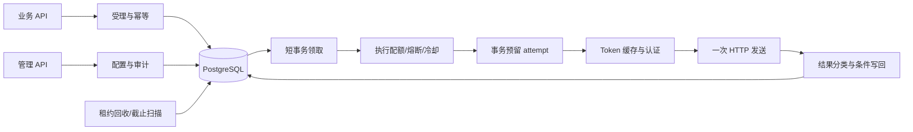

# 内部 HTTP 通知服务技术方案

| 项目 | 内容 |
| --- | --- |
| 依据 | [PRD](PRD.md) 1.0，2026-10-12 |
| 文档状态 | 用户已批准，按 checkpoint 实施；功能完成状态见 Checkpoints 与测试报告 |
| 实施范围 | 按本文与 PRD 开发 MVP，并执行独立测试验证 |
| 实施计划 | [Checkpoints](CHECKPOINTS.md)；详细用例见 [测试设计](TEST_CASES.md) |

本方案以 PRD 为产品契约，选择单个 Spring Boot 应用、PostgreSQL、进程内 Worker。数据库保存配置版本、任务快照与处理状态，网络调用不进入数据库事务。暂不引入 Redis、MQ、微服务、工作流引擎或管理界面。

## 1 已确认的技术判定

以下实现规则已随方案获准进入开发；具体功能是否完成以 checkpoint 报告为准。

| 判定 | 建议规则 |
| --- | --- |
| 可靠性语义 | `202` 仅在事务提交后返回；有界、可恢复且允许重复，不承诺最终成功或 exactly-once |
| 计次时点 | 领取租约不计次；独立事务预留 attempt 才计次，认证失败和预留后宕机也计次 |
| 发送次数 | 一个 attempt 最多一次业务 HTTP 请求；HTTP 客户端禁止自动重试、重定向及认证挑战重发 |
| 时间与租约 | Token 总超时 5 秒，业务 HTTP 总超时 10 秒，attempt 总执行预算 30 秒，租约 90 秒；不续租 |
| 写回所有权 | 校验 ID、`runNumber`、`leaseToken`、`processing`、租约尚未到期；过期但尚未接管也拒绝旧 Worker 写回 |
| 截止时间 | 不在轮次截止后预留新 attempt；截止前已预留的 attempt 可在执行预算与有效租约内完成；独立扫描清理超期 pending |
| 401 恢复 | 仅明确 `401 invalid_token` 可用每轮一次恢复机会；结束当前 attempt，持久化意图，下一 attempt 再取 Token 并计次 |
| 重复提交 | `(tenantId, operation, eventId)` 唯一；原始数据规范化摘要一致返回旧任务，不重新渲染新版模板 |
| 数字与错误码 | 无损处理数字，`1`、`1.0`、`1e0` 等价；缺失/类型错误返回 400，路由或配置不可用返回 422 |
| 配置发布 | 草稿乐观锁；发布内容不可改；绑定一次事务切换；任务固定完整旧版或新版快照 |
| HTTP 成功边界 | 收到完整的最终 `2xx` 响应头即满足 HTTP 确认；不解析业务响应体，不因无用大响应体而改为失败 |
| 最后结果保留 | 纯延期、截止终止和未预留 attempt 的租约回收只改变调度/终止原因，保留上次投递结果；新 attempt 完成或异常回收才更新结果 |
| 多实例边界 | 任务所有权依靠 PG 协调；Token、熔断、并发和冷却均按进程维护，供应商须允许多个实例 Token 共存 |

这些规则落实到数据库约束、事务及自动化断言。任何语义变更先更新设计与用例，再变更实现，不能通过减弱断言取得“通过”。

其中可靠性、计次、单次发送、默认时间、401 下一 attempt、配置版本和进程内边界直接来自 PRD。400/422 的分界、数字等值规范化、过期未接管也拒绝写回、收到完整响应头后的大 Body 处理，以及纯状态转换保留最后结果，属于为自动化断言补齐的实现细化，已随本方案冻结；它们不新增业务功能。

## 2 技术栈与版本依据

| 组件 | 拟采用 | 依据与锁定方式 |
| --- | --- | --- |
| Java | Java 17 语言/API 基线；部署使用受维护的 JDK 17 构建 | 本机只读检查为 OpenJDK `17.0.20`。容器发行版、补丁与镜像摘要在 CP01 实际构建时固定，不绑定本机 Homebrew 路径 |
| Spring Boot | `3.5.16` | 官方该版本要求 Java 17 及以上；用于复用 Spring MVC、JDBC、Security、Actuator。它不是当前最新主线；选择已有成熟生态，CP01 核验维护/安全状态，不把存在版本文档等同于生产支持承诺。[系统要求](https://docs.spring.io/spring-boot/3.5/system-requirements.html) |
| Maven | Wrapper 固定 `3.9.16` | 官方版本已发布；本机 `mvn` 不存在，后续使用仓库 Wrapper 或容器，不要求用户预装全局 Maven。[发布说明](https://maven.apache.org/docs/3.9.16/release-notes.html) |
| PostgreSQL | `17.11` | 官方发布说明可核验；CP01 固定可取得的镜像摘要并执行真实 PG 迁移测试。[发布说明](https://www.postgresql.org/docs/17/release-17-11.html) |
| 数据访问/迁移 | Spring JDBC、HikariCP、Flyway、PostgreSQL JDBC | 由固定 Boot BOM 管理受管依赖；使用显式 SQL，避免 ORM 隐式锁与 flush 行为；Flyway 加入 PostgreSQL 数据库模块 |
| 出站 HTTP | Apache HttpClient 5 | 需要可控 DNS、连接地址、取消请求、大小与时间限制；版本优先由 Boot BOM 固定，CP01 验证所需 API，必要的版本覆盖需附依据。[连接管理 API](https://hc.apache.org/httpcomponents-client-5.6.x/current/httpclient5/apidocs/org/apache/hc/client5/http/impl/io/PoolingHttpClientConnectionManagerBuilder.html) |
| 熔断 | `resilience4j-circuitbreaker:2.3.0` 核心库 | 显式调用许可与结果 API，不使用注解自动包裹重试；该版本官方发布可核验，避免无意引入要求更高 JDK 的升级。[官方发布](https://github.com/resilience4j/resilience4j/releases/tag/v2.3.0) |
| 测试 | JUnit、Spring Boot Test、真实 PG、可编程 HTTP Mock | 受管版本随 BOM；容器/Mock 工具在 CP01 固定准确版本，保留依赖树和校验记录；不在方案阶段伪称兼容验证通过 |

2026-10-12 的只读环境检查还发现 Docker CLI `29.7.2`。这只说明命令存在，尚未验证 daemon、Compose、拉取权限或 Testcontainers。没有安装依赖、拉取镜像或启动容器。所有版本的组合兼容、镜像可获取性、构建与安全修复情况由 CP01 的真实结果裁决；存在不兼容时先修订版本表和证据，不使用 `latest` 悄悄漂移。

## 3 模块与运行角色

采用一个 Maven 应用模块，按包划分职责，不拆多个服务或 Maven 子工程。

| 包 | 职责与主要接口 |
| --- | --- |
| `api` | 通知接入、状态/失败列表、统一错误响应；只调用应用服务 |
| `security` | 内部凭证认证、租户/操作/角色授权、出站目标策略、脱敏 |
| `configuration` | 模板与认证草稿、发布、预览、绑定及回滚；乐观锁与审计 |
| `mapping` | 有限字段路径解析、类型检查、`BodyEncoder` 的 JSON/表单实现 |
| `application` | 受理、状态查询、人工重投用例；控制事务边界 |
| `storage` | JDBC Repository、条件更新、领取/回收 SQL、Flyway 迁移 |
| `worker` | 扫描、供应商轮转、租约、attempt 预留、到期与过期租约恢复 |
| `delivery` | 一次业务 HTTP 发送、结果分类、统一 `RetryPolicy`、取消与时间限制 |
| `auth` | `AuthStrategy`、`SecretResolver`、API Key、OAuth、Token 本地缓存与 singleflight |
| `protection` | 全局/供应商许可、熔断许可、认证/配额冷却 |
| `observability` | 结构化日志、Micrometer 指标、健康检查 |

接口仅用于真实变化点：编码、认证、密钥解析、出站策略以及可注入时间/随机源。不要给每张表或每个供应商生成一套抽象层。

`APP_MODE=api|worker|all` 控制业务/管理 API 与 Worker 的启用；三个模式均提供受限健康端点。API 模式绝不启动调度器。Worker 模式不暴露业务和管理入口。默认 `all` 用于本地演示；生产可同镜像分别部署角色。



## 4 物理数据设计

下表与 SQL 是待实现的迁移规格，不是已经创建的数据库。ID 使用应用生成的 UUID；所有时间用 `timestamptz`，展示为 UTC。调度、租约、轮次截止均以 PG 时间为准。字段必填性、枚举范围、唯一性和引用关系由迁移保证，不能仅依赖 Java 校验。

### 4.1 配置与任务表

| 表 | 主要字段 | 必须落到 DDL 的约束 |
| --- | --- | --- |
| `notification_template_version` | `id uuid`，`template_key varchar(128)`，`version int`，`revision bigint`，`status`，`owner_tenant_id`，`shared boolean`，`provider_id`，`endpoint_group`，`config jsonb`，创建/发布信息 | 主键；`UNIQUE(template_key,version)`；版本/修订号正数；状态仅 draft/published；config 必须对象；共享资源仅全局管理员可修改；发布后禁止 UPDATE/DELETE 内容 |
| `auth_profile` | `id uuid`，`tenant_id varchar(64)`，`profile_key`，`version int`，`revision bigint`，`status`，`auth_type`，`parameters jsonb`，`secret_ref`，创建/发布信息 | `UNIQUE(tenant_id,profile_key,version)`；`UNIQUE(id,tenant_id)`；认证类型仅 api_key/oauth2_client_credentials；参数对象；密钥只存引用；发布后不可改/删 |
| `notification_route` | `tenant_id`，`operation`，`template_version_id`，`auth_profile_id`，`revision bigint`，`updated_by/at` | `(tenant_id,operation)` 主键；模板 FK；`(auth_profile_id,tenant_id)` 复合 FK 到认证配置；revision 正数；发布状态和模板共享权限在切换事务校验 |
| `notification_task` | 事件键、请求摘要、版本引用、固定请求快照、供应商/故障域/配额域、状态、轮次预算、调度、租约、认证恢复信息、最后结果 | 见下方约束与索引；快照、事件键与配置引用受不可变更新保护 |
| `notification_attempt` | `task_id`，`run_number`，`attempt_no`，`lease_token`，开始/结束时间，`phase`，`outcome`，HTTP 状态，错误分类，凭据版本，`request_started_at`，执行截止 | `PRIMARY KEY(task_id,run_number,attempt_no)`；任务 FK；正数计次；合法阶段/结果；结束时间不早于开始；HTTP 状态为空或 100–599；无响应正文、Token、Secret |
| `replay_request` | `task_id`，`replay_request_id`，`request_digest`，`expected_run_number`，`result_run_number`，操作人/原因/时间，`response_snapshot jsonb` | `PRIMARY KEY(task_id,replay_request_id)`；任务 FK；正数轮次；保存已成功重投的固定响应，支持同键重试 |
| `audit_event` | `id`，操作者，租户，对象类型/ID，动作，原因，前后修订摘要，操作请求键，时间 | 主键；敏感操作在业务事务中一并写入；应用只允许 INSERT/SELECT，不允许改删；只存脱敏摘要 |

模板键在系统内全局唯一；模板版本共享与“当前调用者有权修改模板”分别判断。普通租户只能绑定自己拥有或公开共享的模板，以及本租户的已发布认证版本。API Key 请求头不得与模板普通头冲突，绑定时检查。

任务的核心字段规格：

```sql
-- 下列片段定义关键字段和约束；CP01/CP02 将展开为完整 Flyway 迁移。
id uuid PRIMARY KEY,
tenant_id varchar(64) NOT NULL,
operation varchar(128) NOT NULL,
event_id varchar(128) NOT NULL,
request_hash bytea NOT NULL CHECK (octet_length(request_hash) = 32),
template_version_id uuid NOT NULL REFERENCES notification_template_version(id),
auth_profile_id uuid NOT NULL,
route_revision bigint NOT NULL CHECK (route_revision > 0),
provider_id varchar(128) NOT NULL,
endpoint_group varchar(128) NOT NULL,
quota_key varchar(256) NOT NULL,
request_url text NOT NULL,
request_method varchar(8) NOT NULL CHECK (request_method IN ('POST','PUT','PATCH')),
ordinary_headers jsonb NOT NULL CHECK (jsonb_typeof(ordinary_headers) = 'object'),
content_type varchar(128) NOT NULL,
body_bytes bytea NOT NULL CHECK (octet_length(body_bytes) <= 262144),
status varchar(16) NOT NULL CHECK (status IN ('pending','processing','succeeded','failed')),
run_number integer NOT NULL DEFAULT 1 CHECK (run_number >= 1),
run_attempt_count integer NOT NULL DEFAULT 0,
total_attempt_count bigint NOT NULL DEFAULT 0,
max_attempts integer NOT NULL CHECK (max_attempts > 0),
run_started_at timestamptz NOT NULL,
deadline_at timestamptz NOT NULL,
next_attempt_at timestamptz,
defer_reason varchar(64),
lease_token uuid,
lease_owner varchar(128),
lease_until timestamptz,
auth_recovery_used boolean NOT NULL DEFAULT false,
auth_recovery_required boolean NOT NULL DEFAULT false,
rejected_token_digest bytea,
last_outcome varchar(32) NOT NULL DEFAULT 'NOT_SENT',
last_error_code varchar(64),
last_http_status smallint,
created_at timestamptz NOT NULL,
updated_at timestamptz NOT NULL,
UNIQUE (tenant_id, operation, event_id),
FOREIGN KEY (auth_profile_id, tenant_id) REFERENCES auth_profile(id, tenant_id),
CHECK (tenant_id ~ '^[A-Za-z0-9._:-]{1,64}$'),
CHECK (operation ~ '^[A-Za-z0-9._:-]{1,128}$'),
CHECK (event_id ~ '^[A-Za-z0-9._:-]{1,128}$'),
CHECK (run_attempt_count BETWEEN 0 AND max_attempts),
CHECK (total_attempt_count >= run_attempt_count),
CHECK (deadline_at > run_started_at),
CHECK ((status = 'processing' AND lease_token IS NOT NULL
         AND lease_owner IS NOT NULL AND lease_until IS NOT NULL)
       OR (status <> 'processing' AND lease_token IS NULL
         AND lease_owner IS NULL AND lease_until IS NULL)),
CHECK ((status = 'pending' AND next_attempt_at IS NOT NULL)
       OR (status <> 'pending' AND next_attempt_at IS NULL)),
CHECK (last_outcome IN ('NOT_SENT','HTTP_ACKNOWLEDGED','HTTP_REJECTED','UNKNOWN')),
CHECK (NOT auth_recovery_required OR auth_recovery_used),
CHECK (rejected_token_digest IS NULL OR octet_length(rejected_token_digest) = 32),
CHECK (last_http_status IS NULL OR last_http_status BETWEEN 100 AND 599)
```

索引规格：

```sql
CREATE INDEX task_due_idx
  ON notification_task(provider_id, next_attempt_at, created_at, id)
  WHERE status = 'pending';
CREATE INDEX task_lease_idx
  ON notification_task(lease_until, id) WHERE status = 'processing';
CREATE INDEX task_deadline_idx
  ON notification_task(deadline_at, id) WHERE status = 'pending';
CREATE INDEX task_query_idx
  ON notification_task(tenant_id, status, created_at, id);
```

attempt 的组合主键已经支持历史顺序查询，不重复创建等价索引。队列扫描和 SQL 执行计划在真实 PG 验证，数据量增长后再评估索引调整及分区。

### 4.2 数据库与应用共同维护的不变量

发布资源的不可变性使用迁移中的 BEFORE UPDATE/DELETE 触发器兜底：`OLD.status='published'` 时拒绝修改；发布本身允许由 draft 原子转为 published。任务使用触发器或应用数据库角色的列级权限保护事件键、请求快照和版本引用，不允许人工重投改写。FK 默认 RESTRICT，禁止级联删除历史任务。

跨表的“只能绑定已发布版本”、权限校验和预算与 attempt 记录一致性属于事务不变量；不能用假定 PG CHECK 能引用其他表的方式实现。每个预留、完成、回收、重投事务要么全部提交，要么全部回滚。

`replay_request` 独立于审计日志，避免把通用审计 JSON 当成幂等业务存储。相比 PRD 的逻辑模型增加这一张小表，换取可约束、可查询的重投结果。

## 5 接入、幂等与配置版本

### 5.1 受理顺序

1. Spring Security 识别内部凭证，获得 `callerId`、角色、租户和允许操作；校验权限后再查任务，不能通过幂等查询绕过授权。
2. 流式读取上限 256 KiB，严格 JSON 对象解析，拒绝重复键与未知顶层字段；标识按 PRD 校验，`data` 必须是对象。
3. 对原始业务请求生成规范化 SHA-256 摘要；先按唯一事件键查主库。相同摘要返回 `200`、旧任务和 `deduplicated=true`；不同摘要返回 `409`。该路径不读取当前路由或重新校验旧业务数据。
4. 未命中时，通过一条 JOIN 查询取得 route、已发布 template、已发布 auth 的完整版本；在内存校验并渲染快照，不访问供应商/Token 接口。
5. 在短事务中插入 task，保存默认预算 `12` 和数据库时间计算的 `24h` 截止；新任务 `pending`。`INSERT ... ON CONFLICT DO NOTHING RETURNING id` 避免唯一异常使事务失效；无插入结果时在后续 READ COMMITTED 语句读取胜出任务并比较摘要。
6. 外层事务成功提交以后 Controller 才返回 `202`。断网、提交超时或结果不明返回 `503`；不尝试通过删除可能已提交的记录“撤销”。调用方以原事件键重试确认。

业务字段缺失/类型错误返回 400；没有可用绑定、配置组合冲突或无法生成合法请求返回 422。非法外部 URL、保留 Header、静态规则错误应优先在发布时拒绝。完整 HTTP 错误契约沿用 PRD 5.3。

### 5.2 规范化规则

对象键按 Unicode 码点稳定排序；数组顺序保留；字符串保留内容，不做 Unicode 大小写或归一化处理；布尔/null 保持类型。数字使用 BigInteger/BigDecimal 无损解析，以规范化的符号、有效数字和十进制指数参与摘要，`1`、`1.0`、`1e0` 相同，`-0` 与 `0` 相同。不要通过 double 或对极大指数调用无界 `toPlainString()`。

字符串和字段名中的未配对 UTF-16 代理单元返回 400；合法代理对（例如 emoji）保留。这样避免非法字符在 UTF-8 编码中被替换为 `?`，造成不同输入拥有相同规范化字节。该约束在 CP02 代码审查中补齐并加入回归测试。

约定解析深度 64、单个数字词法长度 1000、指数绝对值不超过 10000，超限返回 400，避免很小的原始报文消耗无限内存。摘要包含 tenantId/operation/eventId/data，不含路由版本、渲染结果和动态认证。规范化是本服务定义的稳定格式，不能未验证就宣称符合某种通用 canonical JSON 标准；黄金样例和属性测试固定其行为。

### 5.3 发布、预览和路由切换

草稿更新使用 `WHERE id=? AND revision=? AND status='draft'`，更新成功 revision 加一，否则 409。版本号由管理员显式提供，唯一约束处理冲突，避免 `MAX(version)+1` 的竞争。

validate/preview 只执行本地语法、策略、地址文本和映射校验。预览用样例生成 method/url/普通 Header/Body 的脱敏视图；不解析 Secret、不请求 Token、不 DNS 查询、不发送网络请求。真实目标解析和 IP 安全检查在每次连接前执行。

publish 也要求 `expectedRevision`，对草稿加行锁后校验修订号，冲突返回 409；仅对该已审阅修订执行离线校验，原子保存 `published_by/at` 与审计，避免预览后被其他人修改的草稿悄悄发布。route 更新在一个事务中验证模板共享范围、认证租户、两者已发布且 Header 无冲突，然后按 `expectedRevision` 更新全部引用并写审计。首次绑定以 `expectedRevision=0` 及 INSERT 唯一约束创建，旧 revision=0 不能覆盖已有绑定。

管理接口的模板、认证和路由详情对资源不存在或租户范围不匹配统一返回 404；缺少管理角色仍返回 403。绑定引用不存在的配置返回 404，引用草稿或非法组合返回 400，引用其他租户凭据返回 403。以上是 CP03 对管理错误契约的细化，不改变业务接入时配置不可用返回 422 的约定。

接入使用单条关联读取保证一次读取的完整快照；发布资源不可变，随后渲染期间无需持有行锁。允许绑定刚切换时的在途受理任务使用完整旧配置；回滚只是绑定旧版本，新旧任务各自维持原快照。

### 5.4 映射边界

仅实现对象字段路径、常量、嵌套 fields、必填和类型约束。`from` 与 `constant` 必须二选一，显式 null 常量不等同于缺少配置键。JSON 可直接传递对象或数组，不支持遍历、表达式、条件、SpEL、脚本。表单遵循 PRD 的非空标量规则，拒绝空字符串、null、对象及数组，按 UTF-8 `application/x-www-form-urlencoded` 编码；`false` 和 `0` 是合法标量，不当作缺失。

`from` 使用 `eventId`、`data` 或 `data.<对象字段>...`，每个字段段由 Unicode 字母、数字、下划线或连字符组成，最多 64 段；包含点号的字面字段名、数组下标和通用 JSONPath 不在第一版语法中。

配置存储还有 PostgreSQL JSONB 的表示边界：科学计数法数字可能展开为很长的十进制值，因此入库前有界检查展开后的配置大小不超过 256 KiB，超限返回 400。配置中的 U+0000 因 JSONB 无法表示而拒绝；业务 JSON Body 仍可包含转义后的 U+0000。数据库读取与预览解析在此字节上限内保留精确数值，不使用默认浮点转换或无界展开。入口请求的数字词法长度和指数限制保持不变。

Header 按大小写不敏感的名称去重与禁用检查，名称满足 HTTP token 规则，名称和值禁止 CR/LF；普通头总计 16 KiB。Content-Type 由编码器确定，认证头由认证策略追加，传输控制头由 HTTP 客户端控制。渲染后 Body 以 bytea 保存实际 UTF-8 字节，重试时直接复用；不能每次把 JSONB 再序列化后声称字节快照相同。

## 6 调度、事务和状态机

### 6.1 状态与结果分离

| 状态转换 | 条件 | attempt 变化 |
| --- | --- | --- |
| 新任务 → pending | 受理事务提交 | 0 |
| pending → processing | 到期且取得执行槽位，领取成功 | 不增加 |
| processing → processing | 预留 attempt 与插入记录原子提交 | 本轮及累计各加一 |
| processing → succeeded | 收到 2xx，持有有效租约完成条件写回 | 完成本次记录 |
| processing → pending | 可重试结果且预算充足，或未预留时准入延期 | 前者已计，后者不计 |
| processing → failed | 永久错误或没有后续预算 | 不额外增加 |
| processing → pending/failed | 租约过期回收，检查 attempt、预算与截止 | 已预留保留计数，未预留不补记 |
| pending → failed | 独立截止扫描发现 deadline 到期 | 不增加 |
| failed → pending | 授权且幂等的人工重投 | 新轮次计数归零，累计保留 |

任务的 `last_outcome` 与 attempt 的 `outcome` 为 `NOT_SENT`、`HTTP_ACKNOWLEDGED`、`HTTP_REJECTED`、`UNKNOWN`。failed 可保留 UNKNOWN；不要将其展示为“供应商未执行”。纯准入延期、截止终止、无 attempt 的回收不覆盖原 last_outcome/last_http_status，只更新 deferReason/终止原因；新 attempt 的可观测结果才更新 last_outcome，早前结果始终保存在 attempt 历史。人工重投仅开启新预算，也保留此前最后结果，直到新 attempt 产生结果。

### 6.2 领取事务 T1

每秒扫描当前有到期任务的 provider，按 providerId 游标轮转；候选 provider 分页读完后才重置游标，避免总取前 N 个导致后续供应商饿死。先非阻塞获得供应商槽位，再尝试获得全局槽位；全局不足立即归还供应商槽位，不持全局槽位等待慢供应商。单轮每个供应商小批量领取且总数不超过空闲槽位。

单轮领取预算固定为进入该轮时的空闲槽位数，不因为本轮快速任务完成而扩增。完成后合并触发下一轮补位，调度队列最多保留一个补位事件；这样既避免轮询间隔限制吞吐，也让租约回收和新 provider 扫描持续获得机会。

T1 使用 `SELECT ... FOR UPDATE SKIP LOCKED` 选取指定 provider 下 `pending AND next_attempt_at <= DB_NOW AND deadline_at > DB_NOW` 的任务，按 next_attempt_at/created_at/id 排序，更新 processing、随机 token、实例 owner、`lease_until=DB_NOW+90s`，清空 next_attempt_at 后提交。空领取归还许可；线程池拒绝提交时条件延期或等租约恢复，不能丢任务。

`SKIP LOCKED` 用于队列表消费者，不能当成业务读取的一般一致性保证。[PostgreSQL SELECT](https://www.postgresql.org/docs/17/sql-select.html)

### 6.3 准入与 attempt 预留事务 T2

领取后再次检查本地停止标志、熔断许可、配额冷却、认证失败短冷却和可用时间。拒绝时只条件写入 pending/next_attempt_at/defer_reason，并归还所有许可；不预留 attempt。

允许处理后执行 T2：按 ID 加行锁，再校验当前轮次、token、processing、`lease_until > clock_timestamp()`、deadline 未到、`run_attempt_count < max_attempts`。更新计数，同时插入 `(taskId,runNumber,attemptNo)` 尝试记录，初始 phase=RESERVED、outcome=NOT_SENT、started_at 及 attempt 执行截止。更新和插入在同一事务，失败均回滚。普通查询先取数据库时间；锁等待后重新取当前时间，不用长事务开始时的旧 `now()` 授予新预算。

一次轮次里 attemptNo 连续递增，预留后即消费预算。租约 token 由随机 UUID 生成，Worker 不能凭旧计数推测或复用新租约。

### 6.4 认证与发送

T2 提交后才解析 Secret 与准备认证。准备阶段允许的网络仅是一次 Token 交换或等待同键已有交换，不在 attempt 内对 Token 网络失败循环重试。

业务发送前做一次短事务 T3：再次验证租约/轮次/attempt 未结束与执行时间，将 phase 改为 REQUEST_STARTED、`request_started_at` 设为 DB 时间、outcome=UNKNOWN，记录凭据版本，提交后才发业务 HTTP。T3 失败或提交结果不明时不发送。Worker 还要用单调时钟校验 30 秒总预算，并将业务请求时间上限设为 `min(10s, attempt剩余时间, lease剩余安全时间)`。

剩余预算用数据库产生的 `execution_deadline/lease_until - started_at` 计算，再扣除从 T2 调用前开始的单调计时耗时；不直接拿 Worker 墙钟减数据库时间。计时包含 T2 等待，保守少用部分预算，并为租约保留 20 ms 余量。

T3 是审计意图，无法与网络发送原子化：T3 后、网络前宕机也记录 UNKNOWN。本版对所有已预留但未完成的尝试保守记 UNKNOWN，不用测试屏障知道的“尚未发送”推断真实进程故障；正常处理路径明确未发送的认证失败等才记 NOT_SENT。已预留仍是一次已消费的 attempt，不能删除记录来“修复计数”。

`request_started_at` 仅是上述持久化发送意图时间，不是已发出网络请求的证据。性能测量另在真正调用 HTTP 传输发送的位置记录 `httpSendStartedAt`；不得拿 T3 或 T2 的时间冒充首次 HTTP 开始。文档中的 `acceptedAt` 对应任务受理事务内由数据库生成的 `created_at`，报告注明该采样定义及进程时钟校准方法。

### 6.5 完成事务 T4

先锁任务，校验 ID/run/token/processing/lease_until 尚有效，再校验该 attempt 未结束，然后在同事务中写入 attempt 结果和任务终态或下一次调度。成功会清空 lease 和 next_attempt_at；重试清空 lease，设置 pending 与 next_attempt_at；永久失败清空 lease、设置 failed。任何必要更新不是恰好一行均整体回滚并记录 `STALE_OWNER`，不得只更新历史或只更新任务。

更新语句重新使用 `clock_timestamp()` 校验租约和 attempt 执行期限，完成写入后再次检查，避免已取得任务锁但在后续数据库锁上等待跨过期限。检查失效时整个事务回滚，不能留下部分更新的历史。

`2xx` 以完整最终响应头为确认点；收到响应头之后关闭不需要的响应流，不等待无限流式 body。网络准备、Token 等待和业务执行共同受 30 秒看门狗限制，取消必须关闭实际出站请求；超时后的晚到回调不能再次完成本 attempt。若落库失败，不在当前 attempt 重发 HTTP，保持 processing 由租约回收处理。

deadline 只限制开启新 attempt，T4 不因为轮次 deadline 刚过而丢弃此前正常开始且仍在执行上限内的结果。租约过期始终失去写回权，即使回收器尚未运行。token 保护 PG 状态，不保证已经发出的网络请求停止、不防止供应商重复副作用。

### 6.6 回收与截止扫描

回收器独立小批量锁定 `processing AND lease_until <= DB_NOW`。没有开放 attempt 时说明只领取，保留计数与上次结果；存在开放 attempt 时保守标记 UNKNOWN，写 `LEASE_EXPIRED`，关闭尝试。再检查次数与 deadline：仍可继续则 pending，已耗尽则 failed。整个回收在同一事务，清空旧 token。

deadline 扫描独立使用 deadline 索引处理所有超期 pending，不要求 next_attempt_at 已到期，因此长熔断或 Retry-After 不会形成永久 pending。对租约尚有效的 processing 不提前夺取；它完成或租约到期后再决定终态。次数已耗尽但仍 pending 的异常记录同样进入 failed 并记录不变量告警。

| 故障窗口 | 可观测结果与恢复 |
| --- | --- |
| T1 后、T2 前宕机 | lease 到期重新 pending，不增加 attempt（AT12） |
| T2 后、T3 前宕机 | 已计次、UNKNOWN、不完整尝试保留，不利用测试屏障推断（AT13） |
| T3 后、HTTP 前宕机 | 已计次、UNKNOWN，允许重试 |
| 供应商成功、T4 前宕机 | UNKNOWN，可能重复；Mock 的业务幂等记录验证副作用（AT14） |
| 旧请求晚到、新 Worker 已领取 | 旧 T4 条件失败，不覆盖新 token/轮次（AT15） |
| DB 中断 | 不再新领取/预留/发送；已在途调用结果可能未知，恢复后通过租约处理（AT26） |

## 7 重试、冷却与人工重投

唯一长期重试入口是 Worker 调度；禁止 Spring Retry、HTTP 自动重试或 OAuth 组件在内部透明重发业务请求。重试策略返回 `SUCCESS | FAIL | RETRY(notBefore) | AUTH_RECOVER(notBefore)`，纯计算分类便于表驱动测试。

| 结果 | 调度行为 | 业务熔断样本 |
| --- | --- | --- |
| 2xx | succeeded | 成功 |
| 业务网络暂时故障、超时、5xx | 有预算则退避 | 失败 |
| 408 | 退避 | 不计 |
| 429 | 配额域冷却并退避 | 不计 |
| 明确 401 invalid_token | 一轮最多一次认证恢复，下一 attempt | 不计 |
| 其他 4xx、恢复后再认证拒绝、3xx | failed | 不计 |
| Token 网络故障/429/5xx | NOT_SENT，认证上下文退避 | 不计 |
| invalid_client/unauthorized_client/invalid_scope | NOT_SENT，failed | 不计 |
| 本地非法配置、禁止地址、请求过大 | NOT_SENT，failed | 不计 |
| 准入/熔断/冷却拒绝 | 未预留时延期，deadline 不变 | 不计 |

退避采用 full jitter：`U(0,min(30s*2^(attemptNo-1),1h))`，实现使用饱和计算避免溢出。下一时间取普通退避时间、Retry-After、配额冷却、认证上下文短冷却的最大值；有效 Retry-After 是下限，不做截短。HTTP 日期以 UTC 解析，负数/无效值回到退避，过去的合法日期等于无需额外等待。若 nextAttemptAt 大于或等于 deadline，立即 failed，记录截止原因；attempt 已达 12 次也不再排队。

429 默认 quotaKey 为环境/租户/认证配置版本，可部署配置显式映射实际共享配额范围。将本任务 next_attempt_at 持久化并以本进程 map 更新同配额任务的冷却；多实例不保证全局冷却。Token 的 429 更新认证上下文冷却，不污染业务熔断。

人工重投 T5：鉴权后先查询 replay_request，同键同摘要返回保存的原操作响应，同键不同 expectedRunNumber/原因返回 409。没有记录则锁任务；必须 failed 且 run_number 匹配，才加一轮次、重置本轮计数/认证恢复、保存当前部署的 maxAttempts 和新 24h deadline，保持任务 ID/快照/事件标识/累计次数。插入 replay_request 与 audit_event 后一并提交。等待行锁的竞争请求先重新检查同键记录；不同键只能一个成功，其余 409。当前任务后来进入新状态，也不能改变同一重投键的固定结果。

## 8 动态认证与 Token 生命周期

### 8.1 密钥与缓存键

`SecretResolver` MVP 只实现 `env:NAME`，返回 Secret 值及显式 `credentialVersion`；Secret 与版本成对部署，轮换时升级版本并重启，禁止通过引用改变账号身份。值只在发送范围内使用，不写快照、日志、查询或预览。生产 Secret store 是以后可加的实现。

缓存键为 `(environment,tenantId,authProfileVersionId,credentialVersion,tokenUrl,clientId,clientAuthMethod,normalizedScopes)`。scope 按标准集合去重排序；所有实际授权参数都参与隔离。同上下文不同 operation 可共用，不同租户绝不复用。

缓存条目保存 Token、tokenType、receivedAt、expiresAt、随机 generation 和 SHA-256 Token 指纹。指纹仅用于区分拒绝过的高熵 Token，不作为认证材料；拒绝指纹可以存任务表内部字段，但不出 API/日志。generation 用于本进程 compare-and-remove，不能单凭“再次获取生成了新 generation”认定 Token 值已经改变。

### 8.2 标准交换与有效期

使用统一受保护的出站 HTTP 传输完成 client_credentials 交换；按配置支持 client_secret_basic 和 client_secret_post，正确做 Basic/form 编码，Scope 参数按 OAuth 规范发送。MVP 只接受 Bearer token_type，Access Token 不能为空。可以复用 Spring Security 的协议数据结构或转换器，但不引入其默认隐式缓存/自动刷新与业务重试链；缓存与调度只有本服务这一层负责。

Token 接口总超时 5 秒且包含 DNS/连接/TLS/响应解析；响应 JSON 上限 64 KiB。必须有合法 expires_in 或供应商配置的显式寿命，不解析 JWT 来猜有效期。expiresAt 保守地从发起获取时间计算；使用单调时钟跟踪进程内有效期，壁钟仅展示和审计。剩余寿命须大于 `max(min(寿命*10%,60s),计划业务HTTP耗时+时钟余量)`，余量默认 2 秒。新 Token 仍无法覆盖计划执行时间则报告认证配置不兼容，不无限刷新。

### 8.3 singleflight 与失败保护

按缓存键维护短临界区内的 `Entry{token,inFlight,retryNotBefore}`。命中有效 Token 立即返回；否则第一个线程设置 CompletableFuture 成为 leader，其他线程只等待该 future，不另外发请求。网络访问不持 map/entry 锁。

等待上限取 Token 5 秒和本 attempt 剩余预算的较小值；等待者超时不取消其他任务共用的 leader。leader 完成后原子发布缓存/异常并清理 inFlight；临时失败保留短冷却（默认 1–5 秒带抖动，429 遵循 Retry-After），后续准入在 T2 前延期。等待期间失败的已预留 attempt 消耗预算并记 NOT_SENT。禁止让等待者在 leader 失败后逐个重试 Token 接口。

本地缓存条目数有上限（初始 1000，可配置），清理过期无 inFlight 条目；满载且无法清理时返回受控认证容量错误，由调度退避，不能无限增长或驱逐正在进行的 future。Token 获取线程与连接数有界，取消/关闭能释放占用。

### 8.4 401 恢复精确定义

仅在业务接口返回 401，且合法 `WWW-Authenticate: Bearer` 明确给出 `error="invalid_token"` 时使用恢复策略；普通 401 和 403 直接失败。不从任意响应正文猜过期，不把 API Key 401 当成 OAuth 恢复。

首次明确 invalid_token 的 T4 在同事务中结束当前 attempt，设置 `auth_recovery_used=true`、`auth_recovery_required=true`、rejected_token_digest 与下次时间。预算已尽则直接 failed。T4 成功后按使用时 generation 条件删除本地旧条目，已经更新的缓存不能被旧 401 删除。若进程在持久化后失效缓存前崩溃，任务保存的拒绝指纹仍能阻止复用旧 Token。

后续 attempt 获取 Token 时，缓存中有效且指纹不同的 Token 可直接使用；否则通过 singleflight 重新获取，仍返回同一被拒绝 Token 则终止为 AUTH_REFRESH_REJECTED，不在一个 attempt 里连续取 Token。单纯 Token 临时故障按普通认证重试，恢复意图仍保留；下一 attempt 仍受总次数和 deadline 限制。

T3 记录已使用合格的新 Token 后可清除 required，但 used 与拒绝指纹保留到轮次结束。其后再遇认证拒绝直接 failed，不创建第二次恢复机会。新 Worker/重启也能读到相同规则；一次业务 attempt 绝不因为 401 在原地再发送。

## 9 并发隔离与熔断

初始每进程全局 Worker=10、每 provider=3，使用有界执行池，不把数据库任务无限塞进内存队列。领取按 provider 轮转、先拿供应商许可再拿全局许可；Token 准备也占该任务的供应商槽位，因此坏凭据不能无限吃掉全局执行资源。连接池总量与线程数协调；业务与 Token 出站使用独立的有界连接池，避免 Token 端点堵塞复用同一连接池。

熔断键为 providerId+endpointGroup，Resilience4j count-based window=20、minimumCalls=10、failureRate=50%、open=30s、half-open permits=1。每进程独立维护。显式取得探测许可：只有 2xx 调 `onSuccess`，业务网络/超时/5xx 调 `onError`；其他结果释放许可而不写统计。半开时 Token 准备失败、取消、租约丢失也必须释放，下一健康任务仍可探测。[Resilience4j 熔断说明](https://resilience4j.readme.io/docs/circuitbreaker)

计时与请求完成竞态使用一次性终结标志，保证每个业务请求最多贡献一个熔断结果与一次许可释放。故障任务延期到可探测时间附近加抖动，保留 deadline；独立截止扫描保证最终可收敛。重启会丢本地熔断状态，多进程可以各自探测一次，这属于文档化边界。

入站连接数、请求大小、本地 token bucket 接入速率和积压阈值都设上限。幂等命中请求可在鉴权和基础保护后优先返回，新增受理才检查容量阈值；已返回 202 的任务不能被容量策略删除。积压阈值允许近似，不承诺多实例精确总配额；返回 429/503 时带可解释错误码。

## 10 出站安全与资源限制

业务 URL 和 Token URL 走同一 `OutboundPolicy`。解析标准 URI，拒绝 userinfo、fragment、非 HTTP(S)、异常端口、混淆主机格式；生产仅 HTTPS 443 或显式批准端口，域名按 IDNA/大小写规范化后严格匹配允许列表。Header 不承载入站内部凭证，模板中不保存 Secret。

实际连接的 DNS Resolver 返回前检查全部 A/AAAA 候选；发现禁止地址则拒绝这次解析。检查 IPv4、IPv6、IPv4-mapped IPv6、回环、私网、链路本地、组播、未指定/保留和云元数据地址，不仅调用 `isSiteLocalAddress()`。允许列表并不替代 IP 检查。[OWASP SSRF 指南](https://cheatsheetseries.owasp.org/cheatsheets/Server_Side_Request_Forgery_Prevention_Cheat_Sheet.html)

检查后的 InetAddress 直接交给连接器使用，不允许校验后走第二次 DNS；Host/SNI 与 TLS hostname verification 仍使用原始允许域名。连接复用仅能复用已检查地址，目标策略变更需要重启并清空连接池。禁止系统代理自动继承、自动重定向、Cookie 共享、透明认证挑战重发和隐式重试。开发/test 仅显式放行指定 Mock 名称、端口及 CIDR，生产 profile 不能接受该例外。

不能仅把 `responseTimeout=10s` 当作整个请求 10 秒：连接池等待、DNS、连接、TLS 和响应处理要被外层单调时钟 deadline 覆盖，超时主动取消并关闭请求。DNS 使用有界解析执行器和有限等待；即便 OS 解析无法立即中断，滞留线程数也须有上限，不无限创建新线程。CP01 先验证客户端这些控制点可用，CP08 用真实连接验证 SSRF/超时边界。

业务响应最多丢弃 64 KiB，超过即关闭连接，仍依据已收到的最终 HTTP 状态分类；不记录响应正文。Token 响应必须完整解析且不能超 64 KiB，超限属于认证协议失败。限制响应头总大小和压缩后解码大小，MVP 可关闭自动响应解压缩。拒绝无效 TLS 证书，不添加 trust-all 测试捷径。

## 11 查询、日志、健康与运维

单任务查询同时限制 tenantId，越权与不存在统一 404；失败列表按 `(created_at,id)` keyset 分页，游标携带排序键并校验结构，租户与过滤范围始终按本次授权请求重新限定，默认 20、最多 100。返回状态、轮次/次数、调度和截止、最后结果、错误代码和配置版本，不返回 Body、认证头、密钥值或 Token 指纹。审计查询也按权限限制。

结构化日志保留 requestId/notificationId/tenantId/operation/providerId/runNumber/attemptNo/phase/耗时/errorCode。对供应商错误只使用本服务枚举和允许的状态字段，不直接打印异常携带的请求、响应或 Secret。预览的动态业务值默认掩码，保留字段路径/类型/长度与编码格式供核验；精确字节由使用非敏感测试夹具的自动化测试验证。

指标包括受理/冲突/拒绝、任务各状态数量、最老到期等待、attempt 结果/延迟、租约回收、Token 获取/等待/失败、熔断、冷却和数据库/HTTP 连接池等待。指标标签使用受控 provider/errorCode/phase，避免 eventId/notificationId/任意 tenantId 造成高基数。需按租户排查时使用受权限控制的日志/查询。

live 仅反映进程存活；ready 检查数据库、schema 与本角色初始化。供应商故障不使 API ready 失败。关闭时先拒绝新增处理并停止领取，最多等待当前 attempt 的有界时间，然后取消网络、关闭资源；强杀时靠 PG 租约恢复，不做未完成任务的“批量成功”。

MVP 不自动清理任务/尝试/幂等/审计；提交说明要明确增长代价。生产保留期、归档、敏感数据访问、数据库备份与 RPO/RTO 是独立上线条件，不靠本机 Compose 宣称已实现高可用。

## 12 部署与验证方案

后续仓库包含 Maven Wrapper、Dockerfile、Compose、Flyway SQL、环境变量样例、两个协议 Mock、OAuth Mock、示例管理/提交请求与自动化测试。Compose 提供 `all` 单实例，以及 `api+worker-1+worker-2` 双 Worker profile；PG 使用具名数据卷，样例凭据仅为明确的测试值。

迁移与应用启动分开编排：迁移成功后 API/Worker 才 ready；同版本并发启动不手工执行重复 DDL。应用数据库账户非超级用户，schema 迁移使用独立权限；关键持久化参数不得关闭 fsync/synchronous_commit 来伪造性能。Docker 单机方案只用于复现，不等于生产 HA。

JUnit 纯函数测试覆盖映射、摘要、分类；JDBC 集成测试全部使用真实 PostgreSQL，禁止 H2 替代锁/事务语义。端到端测试使用真实应用 HTTP、真实 PG 和可编程供应商 Mock；Mock 只模拟外部供应商，不能用 Stub Worker 或手工改成 succeeded 替代系统行为。双 Worker/强杀场景运行两个独立 JVM/容器，采用测试 profile 中可控阻塞点精确定位 T1/T2/T3/T4；生产构建不暴露故障注入入口。

AT01–AT28 全部需要证据。供应商调用次数不等于业务副作用次数，AT14 的 Mock 必须分别记录二者。时间类测试允许缩短预算与注入时钟/随机源，但不能跳过数据库租约和实际网络链路。并发测试用屏障建立竞态，不靠增加 sleep 期待偶现。

性能按 PRD 执行 10 租户、约 1 KiB、20 rps 持续 10 分钟、供应商 100 ms/200；记录接入 P95≤300 ms、从数据库 acceptedAt 至首次业务 HTTP 开始发送的 P95≤3 秒（包含 Token 等待），另报至首次 attempt 预留的调度延迟，不能以较早的预留时点替代投递指标。核对每个已受理 ID 与最终状态，未发送任务单列失败/未完成，不从样本中静默剔除。压力和突发测试显示内存/连接有界、容量保护与排空，失败或未执行如实记录，不能把目标写成现有能力。

## 13 取舍、风险与演进

| 决策 | 本版代价及演进触发 |
| --- | --- |
| PG 同时做任务队列 | 更新与轮询增加数据库负载；先依据执行计划、等待、膨胀/归档指标优化，再引入 Outbox+MQ |
| 固定快照、不可变版本 | 历史任务会继续调用旧协议；新旧兼容窗口和排空由接入流程管理，普通 replay 不重渲染 |
| 本地 Token 与保护 | 多实例额度叠加；只有共享 Token/集群额度成为真实约束才引入 Redis 或指定投递分组 |
| 无续租、有界 attempt | 长暂停仍会重复投递；简单恢复机制加供应商幂等，未来出现必须长执行的需求再设计续租 |
| 严格有限映射 | 特殊 HMAC/XML/动态路径需要策略扩展；拒绝把模板变成可执行语言 |
| 基于 HTTP 状态成功 | 200+业务错误体仍成功；特定供应商需要显式响应策略及契约测试后扩展 |
| Java 17 与保守依赖组合 | 易于本机及容器复现；CP01 验证安全维护状况，需要升级时整体验证而非混用不兼容依赖 |

最需先验证的工程风险是安全 DNS 与总超时能否实际控制连接、lease/attempt 分阶段是否存在遗漏写回路径、Token 条件失效与跨进程恢复标记是否一致、健康供应商能否持续获得执行机会。相关断言分别落在 CP01/CP04/CP06/CP07/CP08/CP09，不能仅靠设计描述关闭风险。

README、实际测试报告与 AI_USAGE 是最终交付的一部分。AI 使用说明由真实历史对话和后续实现记录提取；当前文档不能预填“AI 实现已验证”或把本建议冒充用户已亲自完成的决策。开发开始前必须取得用户对方案与 checkpoint 的评审确认。
